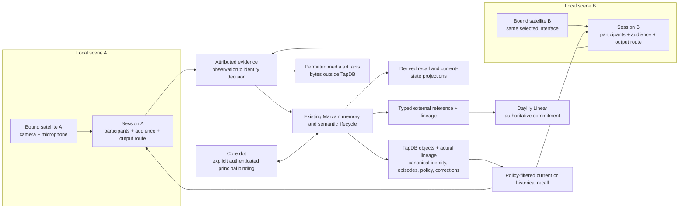

# Marvain 4.x actor, memory and local-scene contract

**Date:** 9 November 2026. **Disposition:** implementation specification for approved Waves 1–4, aligned to the canonical foundation in commit `fc67c79` and A6's active integration handoff. Source work is not a deployed or demonstrated capability; final hub wiring remains in progress.

This implements section 17 of [/Users/jmajor/projects/marvain/docs/design/MARVAIN_GLOBAL_DESIGN_OBJECTIVES_AND_REQUIREMENTS.md](/Users/jmajor/projects/marvain/docs/design/MARVAIN_GLOBAL_DESIGN_OBJECTIVES_AND_REQUIREMENTS.md). The execution specification and authority remain in [/Users/jmajor/projects/marvain/docs/plans/20261109_marvain_4x_multiagent_execution_plan.md](/Users/jmajor/projects/marvain/docs/plans/20261109_marvain_4x_multiagent_execution_plan.md); Linear owns execution state. This document defines the shared domain contract, not a second backlog.

The user selected the existing camera/microphone satellite as the initial sensor interface. TapDB is canonical for semantic identity, evidence, episodes, memory, policy and lineage. Retain the exact `daylily-tapdb[admin]==6.0.8` dependency: A2's source comparison found the required connection, factory, lookup and graph APIs in that tag. The newer Dayhoff pin does not require a Marvain upgrade.

## 1. Architecture and boundaries

The two satellites in this diagram are required scenario bindings, not claims that two configured devices presently exist. The same software actor may serve both scenes through distinct runs and sessions. Shared memory does not merge room context, recipient lists or output devices. A sensor provides evidence; a speaker provides an output route; neither becomes an actor by being attached to the system.

Use the existing boundary in [/Users/jmajor/projects/marvain/layers/shared/python/agent_hub/semantic_tapdb.py](/Users/jmajor/projects/marvain/layers/shared/python/agent_hub/semantic_tapdb.py) and lifecycle in [/Users/jmajor/projects/marvain/layers/shared/python/agent_hub/semantic_lifecycle.py](/Users/jmajor/projects/marvain/layers/shared/python/agent_hub/semantic_lifecycle.py). No additional semantic-store facade, generic graph engine, parallel canonical memory or raw SQL against TapDB tables is introduced. S3/media bytes, vectors, transport, current device state and query projections retain their specialized roles.

## 2. Identity contract

| Concept | Meaning and required distinction | Persistence contract |
|---|---|---|
| Actor | A durable individual, with kind `human`, `animal` or `software_agent`; name is a label, not identity | One typed TapDB instance using the existing person/agent template or explicit animal template, linked to evidence and history |
| Principal | An authenticated service/account subject: issuer and subject, plus explicit tenant/workspace scope where the provider supplies it | Separate typed instance, explicitly bound to an actor; credentials stay outside properties |
| Software run | One execution of a software actor, using a specified principal | Separate run object with origin, run key and start time; restart is not an actor replacement |
| Session | One conversation lifecycle with participant and routing context | Reuse conversation/session object and existing opening/active/reconnecting/closed/failed/reconciled lifecycle |
| Scene | Time-bounded local context at one space, including observations, participants and explicitly selected routes | Separate scene identity linked to space and session; multiple scenes may coexist |
| Embodiment | An actor's explicitly declared use of a device/body during a stated interval | Separate relationship/object linking an actor and persisted device; no implication of control authority |
| Observation | A source's captured measurement, media span or authenticated message | Persisted evidence with source and time; it can remain unattributed |
| Local track | A source-local continuity label | Qualified by source and scene/session; cannot serve as a global actor ID |
| Identity hypothesis | A proposed association of observation/track with an actor | Candidate, supporting evidence, confidence/basis and decision state; never silently promoted |
| Presence assertion | An evidence-backed claim that an actor was observed at a place and time | Links decision/evidence, actor and scene; last observed is distinct from current availability |

All canonical identifiers come from persisted TapDB objects. Application UUIDs, provider event IDs, source keys and deduplication keys are separate identifier classes. No constructed identifier is presented as a TapDB EUID. No human, animal or software identity is inferred from a shared name, prompt, model, voice, account email or embedding similarity.

Human biometric association retains the existing consent and authenticated review path. Animal identity uses a distinct actor kind and an explicit authorized caretaker association to retained observation evidence. That records the caretaker's assertion and basis; it does not claim human face/voice models support animal identification. The initial scope supports individual animal continuity through those associations. Automatic animal matching needs a separately selected supported model/provider before it can be represented as implemented.

For software actors, distinguish configured identity from request provenance. The intended `john@daylilyinformatics.com` core dot requires an explicit account/resource-principal binding. Standard MCP OAuth can authenticate the linked resource principal; it does not by itself attest a native dot identity, native run or ChatGPT workspace. A Marvain-issued bridge run must be labeled as such. Unknown provider-native identity stays unknown.

## 3. Existing boundary and implementation handoff

The following are the **implemented Marvain foundation interfaces**, not provider APIs. The scene/session graph helper is part of A6's active integration. A6 owns shared request/authentication wiring. Callers pass persisted `SemanticObject` references to relationships, not arbitrary strings claimed to exist. The table describes source behavior, not an executed demonstration.

| Interface on `MarvainSemanticLifecycle` | Required input/result semantics |
|---|---|
| `create_actor` | Explicit kind, display name and allowed scalar properties; returns persisted actor |
| `record_principal` | Persisted actor, issuer, subject and name; atomically creates a distinct principal, typed external reference and actor/principal linkage. Authentication/source scope are established by its caller |
| `record_run` | Persisted software actor/principal, run key and aware start time; optional scene/session. The bridge owns the meaning and provenance of the run key; this method does not attest a native provider run |
| `scene_session_graph` | Persisted space/device, session key, start time and explicit policy/owner/readers; returns a graph-write bundle for a distinct scene and session, to be committed through the transactional writer |
| `record_embodiment` | Persisted actor/device and declared relation; does not grant action permission |
| `record_situated_evidence` | Event ID/type, observed/received times, scene/session, device or authenticated source principal, optional actor/run, detail and policy/owner/readers; atomically records evidence and its source/context/policy lineage |
| `record_episode` | Scene/session, participants, evidence, occurrence time, detail and policy/owner/readers; atomically records a canonical episode and links. Event ordering and any interval detail remain explicit in `detail` |
| `record_actor_association` | Observational evidence, established animal, human author, authenticated principal, association basis/time and policy; records caretaker association after caller authorization |
| `commit_scoped_memory` | Evidence, canonical episode, participants, content/kind, recorded/effective times and policy; atomically creates candidate, committed memory and provenance lineage |
| `correct_memory` | Distinct committed original/replacement, author/principal, supporting evidence, reason, recorded/effective times and policy; atomically appends correction links and replacement → original `SUPERSEDES` |
| `recall_scene` | Scene/session semantic IDs, authenticated principal, access time, as-of time, explicit historical/export selection; reads canonical lineage and returns policy-eligible memory, episode, evidence and correction context |
| `prepare_scoped_export` / `plan_scoped_recovery` | Select authorized scene recall for export and describe required owning-store recovery. The selection is not a complete backup and the plan performs no restore |

`TapdbSemanticStore.create_object` delegates to `InstanceFactory.create_instance`; `link_objects` delegates to `InstanceFactory.link_instances`, creating actual `generic_instance_lineage`. `create_graph` commits one object/link bundle atomically; `create_graph_in_session` uses the caller's TapDB transaction so the writer can own idempotency and its sync receipt. `GraphObjectRef.key` is an operation-local symbol, never an EUID. `read_view` resolves canonical instances and lineage in one read transaction. DTO fields such as participant IDs are transport/search projections of those relations, not their authority.

The 4.x path uses explicit parent → child direction: actor → principal `AUTHENTICATED_AS`; principal → typed reference `has_external_reference`; actor → run `HAS_RUN`; scene → space `IN_SPACE`; session → scene `IN_SCENE`; episode → evidence `DERIVED_FROM`; candidate → evidence `DERIVED_FROM`; candidate → memory `COMMITTED_AS`; memory → episode `IN_EPISODE`; memory → actor `ABOUT_ACTOR`; correction → original `CORRECTS`; correction → replacement `REPLACEMENT`; and replacement → original `SUPERSEDES`. Source/context and owner/reader edges originate at the governed object. Scene identity is distinct from space identity. The older `record_event_evidence` / `commit_memory_from_evidence` helpers remain separate source surfaces; their older edge direction is not the traversal contract for `commit_scoped_memory` and `recall_scene`.

A2 owns canonical foundation and templates. A3 owns observation/association, scenes and satellite/worker routes. A4 owns the dot bridge. A5 owns the intentional Daylily work bridge. A6 connects those contracts to supported hub/CLI/configuration entrypoints. A0 owns integration decisions, commits and Linear receipts.

## 4. Evidence, episode detail and corrections

Preserve the following as structured values; a narrative summary is an additional view.

| Record | Required detail |
|---|---|
| Source evidence | Owning source event key, authenticated source/device/principal, occurrence/capture time, receipt time, source modality, scene and session, exact artifact/span when retained, content/measurement, governing policy |
| Attribution | Speaker/actor when established; otherwise unknown/ambiguous state and applicable hypothesis; intended recipients; asserted actor versus authenticated author distinguished |
| Epistemic class | `observation`, `attributed_claim` or `interpretation`; “participant said X” is an observed claim, not evidence that X is true |
| Episode | Ordered evidence references, beginning/end, participants and their roles, linked scenes/sessions, material detail and derived summary |
| Durable knowledge | Assertion content, effective interval where known, supporting episode/evidence, author/provenance, confidence/basis and current status |
| Correction | Target assertion/association, replacement or retraction, reason, authenticated author, supporting evidence, recorded time and effective time |

Occurrence time and receipt time remain separate. Late arrival may enrich an earlier episode; it does not make stale observation current or fabricate movement. An episode may deliberately connect activity across sites, while each evidence item retains its original scene, attribution and audience. Connecting episodes does not disclose all of either scene.

An identity decision corrects the assertion/association, not the source bytes. Retain earlier assertions as history with correction lineage. Current recall follows the effective accepted correction; historical recall reports what was asserted at the requested time, its later correction and its basis. Conflicting unresolved assertions remain explicit. A correction cannot silently broaden audience or extend the underlying evidence's retention permission.

## 5. Audience, retention and recall

These implement the existing product requirements for consent, audience and retained detail. They are not new operational budgets, monitoring controls or secondary checks on successful tools.

The canonical policy values use immutable `MemoryAccessPolicy`, `MemoryPolicyConstraint` and `RetentionDecision` contracts. Policy scalar values are stored on the governed object; owner/readers are actual lineage. The policy requires an owner principal, explicitly permitted reader principals, permitted purposes (`recall`, `detail`, `history`, `export`), explicit raw-capture permission, and one retention decision for every layer: raw artifact, attributed event, episode and durable knowledge. Each layer specifies an expiry timestamp or the explicit choice `retain_until_revoked`; no missing value implies indefinite retention. An absent applicable policy is a configuration error.

Audience relationships are backed by lineage. The authenticated principal is supplied by the existing authentication boundary; a caller-provided reader list or actor ID cannot grant itself access. A service principal may retrieve only through its declared delegation and purpose. Ambient presence, space membership or the same agent ID is not a disclosure grant. Animal subject identity does not grant a caretaker blanket access to other participants' memories.

1. Resolve caller authentication and explicit purpose in the hub/bridge boundary.
2. Determine eligible evidence/memories from the governing policy at request time, including expiry, revocation and audience. Derived material must satisfy every underlying policy for each disclosed source item.
3. Select current or explicitly requested historical view. Normal recall includes current committed, unexpired, unretracted material; historical view additionally requires the `history` grant and labels superseded assertions.
4. If an integration uses the existing hybrid ranker, supply only eligible candidates. `recall_scene` itself reads canonical scene/session lineage; it does not call the ranker or turn an embedding projection into authority. Rank scores never override authorization or lifecycle eligibility.
5. Return concise answers with permitted evidence/episode references; `detail` access expands only material the caller may inspect. If raw media has expired or was never retained, report that exact limitation.

Historical queries do not bypass current access restrictions or recover expired content. Expiry removes content from read eligibility; physical erasure, lifecycle tombstones, artifact deletion and projection removal remain distinct owning-store operations. No automatic purge, destructive deletion, recovery procedure or new schedule is authorized by this specification. Report a purge only from its actual controlling result. Existing export/recovery contracts remain the applicable path when separately selected.

Concrete retention durations, raw-media selection, readers, allowed sharing between sites and caretaker authority are still user choices before live capture. The source contract supports those choices without assigning them silently.

## 6. Two-scene routing and selected sensor

Reuse the camera/microphone location-node and remote-satellite path. Each scene requires an explicit persisted location/space, registered device route, session/room binding, source configuration, selected output route and audience. Two location scenes use two distinct endpoint bindings of the same selected interface. Missing second endpoint/site identity prevents the live two-scene scenario; it is not replaced with an invented device or alternate sensor.

The transport envelope carries source event identity, source device/principal, scene/session, source occurrence and hub receipt time, modality, attribution state, intended recipient/audience and applicable correlation/delegation references. The trusted boundary resolves source identity from authentication and registered routing. A3 may package this as typed local DTOs; field names are not a claim about camera-driver or provider APIs.

Route replies to the originating session and selected output device unless the authenticated request deliberately names another permitted destination. Shared actor memory never causes broadcast to both rooms. Reconnect reuses the owning session lifecycle and route epoch; it does not silently create a replacement actor or relabel delayed media as current. Keep existing availability/freshness controls and their distinctions between observation, last-seen state and offline state; add no guessed latency cutoff.

The current worker explicitly distinguishes voice/face recognition hypotheses from review decisions, and visual prompt context from absent visual access. Preserve those distinctions. Sensory description without a retained artifact must say which observation it derives from. A software actor's synthesized voice is output evidence, not proof of service identity. Camera/microphone selection authorizes source preparation only; capture and enrollment are separate live actions.

The selected source-level transport is an owning upload intent followed by authenticated hub upload: `POST /v1/artifacts/upload-intents` with `upload_via_hub=true`, then `PUT /v1/artifacts/{artifact_id}/upload`. The hub performs one S3 PUT and uses that controlling result to persist the artifact result. The satellite subsequently submits `POST /v1/events` with the returned artifact ID. This path does not use HEAD, checksum/size readback, or a client assertion of upload completion as a second success gate. A3 is aligning the satellite and A6 is integrating the hub path; this paragraph is the selected contract, not a claim that it has run.

| A6-selected route | Source-level role and readiness |
|---|---|
| `POST /v1/livekit/device-token` with optional `session_id` | Create or deliberately reuse the device's session. Canonical scene/session/source binding is in progress; the route fails closed while required binding is unavailable |
| `GET /v1/sessions/{session_id}/worker-lifecycle` | Hydrate the owning session lifecycle before worker participation; scene/space identities remain distinct |
| `POST /v1/scenes/{scene_euid}/recall` | Bind authenticated caller and session to canonical `recall_scene`; integration in progress |
| `GET /v1/spaces/{space_id}/events?session_id=...` | Fetch only the selected session's event context for local conversation |

Hub source binding must carry actual written scene/session results from the graph writer. A queued outbox receipt is not a persisted canonical scene ID, and a space ID is never substituted for the scene ID.

## 7. Core dot and deliberate Daylily handoff

The supported source direction is a custom remote OAuth MCP plugin/resource integration. A4's source research identifies MCP Events as the documented event-delivery route; exact availability and ownership of a subscription for this particular dot remain unbound. No native dot endpoint, run-attestation claim or live subscription is invented. Relevant provider documentation: [dot computers and apps](https://learn.chatgpt.com/docs/dots/computers-and-apps), [custom MCP server](https://developers.openai.com/api/docs/guides/custom-mcp-server), and [MCP Events](https://developers.openai.com/plugins/build/mcp-events).

Native dot notes remain provider-owned. Marvain may record an explicit typed external reference and lineage to an authorized note or message, with provider/account/resource identity, owning object key and returned URL when available. It does not duplicate the native note store or treat a copied note ID as canonical actor identity.

A4's source-level tool handoff is `begin_run(scene_euid, request_key)` returning a persisted Marvain run EUID; `recall(run_euid, query)` returning current authorized episode detail; and `record_update(run_euid, request_key, text)` recording an attributed update. These are proposed Marvain MCP tools, not native dot APIs. The resource boundary resolves principal, permitted scene/session and audience server-side. Model arguments cannot claim a native dot/task/run identity or impersonate a device/person attribution. The OAuth binding includes the allowlisted issuer/client/subject. Event delivery remains explicit configuration and source preparation.

Only an intentional commitment request enters Daylily. Preserve the request's original completion goal and deliverable, authenticated requester/delegation, one canonical Linear issue reference, execution status, substantive checkpoint/next move, attention owner, delivery status and acknowledgment/review state. Linear remains authoritative; Marvain's local record is an evidence-linked reference/projection, not a second task database. A comment success is a comment receipt, not proof that an issue or delivery was completed.

Use a typed external-reference object with actual provider/account/workspace identity and owning issue ID/URL. Link it to the initiating episode and request. A spoken idea, animal observation or sensor event does not automatically create an issue. `Stalled` follows the agreed substantive checkpoint; absence of a configured checkpoint is reported as missing, not inferred failure. Done with an unread result remains distinct from an unfinished review decision. No reminder, subscription or notification is activated by preparing this source.

## 8. Proposed initial demonstration scenario

This is a product scenario for a later authorized demonstration, not a test run or capture authorization. Labels below are scenario roles, not persisted identities or invented EUIDs.

| Role | Binding needed before execution |
|---|---|
| Human A and Human B | Two actual consenting people and their explicit authenticated/canonical associations |
| Animal A | Actual individual animal, chosen caretaker authority and observation association |
| Situated Marvain and core dot | Two distinct software actors; selected principals and run bindings; intended core-dot account is `john@daylilyinformatics.com` |
| Site A and Site B | Two actual sites/spaces and separate registered camera/microphone satellite routes, sessions and intended outputs |

1. Start the two explicitly selected local sessions concurrently. Human A and Animal A participate at Site A; Human B participates at Site B. Marvain retains separate scene participants, audiences and output routes.
2. At Site A, Human A describes a concrete interaction involving Animal A and a visible object. Retain the permitted transcript span, visual observation, actor attribution and event order. Distinguish directly observed behavior from Human A's explanation.
3. During the same interval, Human B discusses an unrelated detail at Site B. Reply only at Site B. Its content must not enter Site A's local conversation merely because the software actor serves both scenes.
4. The core dot deliberately requests permitted episode detail through its bound principal. Its answer identifies the source site, actor and time, with expandable permitted evidence. Its native notes remain distinct.
5. A participant later asks for the specific Site A detail. Recall the event sequence and supporting evidence rather than only a compressed summary. If a later interaction occurs in the other site, disclosure follows the explicit cross-site audience policy.
6. Correct a mistaken attribution through an authenticated decision. Current recall uses the corrected association; an authorized historical view explains the earlier assertion and its correction without rewriting the original observation.
7. Human A explicitly asks to track one resulting commitment in Daylily. Use the selected existing Linear workflow and return its real canonical issue reference. Preserve the original outcome, checkpoint, attention ownership and delivery/review meaning.

Expected evidence is the owning services' normal records: separate session/route identities; observed events and hypotheses/decisions; actor/episode/source lineage; scoped current/historical recall; one intended Linear commitment reference. Existing controlling success results supply operation outcomes. No checksum replay, secondary probes, performance benchmark or extra success gate is added. Physical actuation is outside this initial scenario.

At source level, the later demonstration follows the selected device-token/session binding, reads that session's worker lifecycle, sends permitted artifacts through the owning hub PUT, and submits their event references. Situated evidence, episode and committed-memory graph operations then supply canonical lineage for the scene recall route. Reconnect names the existing session explicitly; context reads remain session-scoped. This sequence is a narrative of intended calls only. Final integration, deployment, live capture and the demonstration have not been executed by this documentation work.

## 9. Source disposition and limitations

This is the bounded source reading for the contract, not runtime acceptance. Foundation observations below reflect implemented A2 source and the active A6 handoff; explicitly marked baseline gaps are historical. Paths below are the owning implementation surfaces.

| Disposition | Source | Contract implication or limitation |
|---|---|---|
| Implemented foundation | [/Users/jmajor/projects/marvain/layers/shared/python/agent_hub/semantic_tapdb.py](/Users/jmajor/projects/marvain/layers/shared/python/agent_hub/semantic_tapdb.py) | Factory-backed `create_graph` / `create_graph_in_session`, canonical `read_view`, lookup and graph service; caller/writer owns retry idempotency |
| Implemented foundation; hub integration in progress | [/Users/jmajor/projects/marvain/layers/shared/python/agent_hub/semantic_lifecycle.py](/Users/jmajor/projects/marvain/layers/shared/python/agent_hub/semantic_lifecycle.py) | Atomic situated evidence, actor association, episode, scoped memory/correction and canonical recall. `scene_session_graph` prepares distinct scene/session writes. The initial separate-write gap is historical |
| Implemented foundation | [/Users/jmajor/projects/marvain/layers/shared/python/agent_hub/memory_service.py](/Users/jmajor/projects/marvain/layers/shared/python/agent_hub/memory_service.py) | Explicit policy/retention, source-policy intersection and temporal correction selection alongside existing commit/annotation/ranking contracts |
| Retain/extend | [/Users/jmajor/projects/marvain/layers/shared/python/agent_hub/memory_taxonomy.py](/Users/jmajor/projects/marvain/layers/shared/python/agent_hub/memory_taxonomy.py) | Existing memory kinds and provenance classes; epistemic class is an additional distinction, not replacement taxonomy |
| Extended owned templates | [/Users/jmajor/projects/marvain/tapdb_templates/MVN/marvain.json](/Users/jmajor/projects/marvain/tapdb_templates/MVN/marvain.json) | Explicit animal, principal, run, embodiment, episode, association and correction types; A6 adds distinct scene. Existing human/software actor templates remain in use |
| Graph support implemented; hub binding in progress | [/Users/jmajor/projects/marvain/layers/shared/python/agent_hub/semantic_outbox.py](/Users/jmajor/projects/marvain/layers/shared/python/agent_hub/semantic_outbox.py), [/Users/jmajor/projects/marvain/functions/tapdb_writer/handler.py](/Users/jmajor/projects/marvain/functions/tapdb_writer/handler.py) and [/Users/jmajor/projects/marvain/functions/hub_api/api_app.py](/Users/jmajor/projects/marvain/functions/hub_api/api_app.py) | `enqueue_semantic_graph` and writer `create_graph_in_session` replace the initial record-only limitation. Hub source binding, session reuse, recall and artifact PUT integration remain active work |
| Retain/extend | [/Users/jmajor/projects/marvain/layers/shared/python/agent_hub/recognition_service.py](/Users/jmajor/projects/marvain/layers/shared/python/agent_hub/recognition_service.py) | Existing observation → hypothesis → authenticated review → presence contract; baseline candidate/consent fields are person-specific |
| Retain with stated limit | [/Users/jmajor/projects/marvain/apps/recognition_worker/worker.py](/Users/jmajor/projects/marvain/apps/recognition_worker/worker.py) | Voice/face evidence and proposals; no source evidence of an animal identity recognizer |
| Extend selected path | [/Users/jmajor/projects/marvain/apps/remote_satellite/location_node.py](/Users/jmajor/projects/marvain/apps/remote_satellite/location_node.py), [/Users/jmajor/projects/marvain/apps/remote_satellite/hub_client.py](/Users/jmajor/projects/marvain/apps/remote_satellite/hub_client.py) | Existing AV transport and authenticated device routes; exact hardware is not chosen. Baseline invalid-mode fallback must not be relied on for this slice |
| Retain/extend | [/Users/jmajor/projects/marvain/layers/shared/python/agent_hub/session_lifecycle.py](/Users/jmajor/projects/marvain/layers/shared/python/agent_hub/session_lifecycle.py) and [/Users/jmajor/projects/marvain/apps/agent_worker/worker.py](/Users/jmajor/projects/marvain/apps/agent_worker/worker.py) | Existing session state/reconnect/room binding and visual-context semantics; richer scene/actor context needs explicit integration |
| Retain authentication boundary | [/Users/jmajor/projects/marvain/layers/shared/python/agent_hub/agent_lifecycle.py](/Users/jmajor/projects/marvain/layers/shared/python/agent_hub/agent_lifecycle.py) | Authenticated lifecycle authorship exists; new dot principal must not bypass it with request-supplied identity |
| New bounded integration | [/Users/jmajor/projects/marvain/layers/shared/python/agent_hub/dot_bridge/](/Users/jmajor/projects/marvain/layers/shared/python/agent_hub/dot_bridge/) and [/Users/jmajor/projects/marvain/plugins/marvain/](/Users/jmajor/projects/marvain/plugins/marvain/) | Planned A4 source surface; remote MCP and event contract need exact connection binding before live use |
| Retain/add work contract | [/Users/jmajor/projects/marvain/layers/shared/python/agent_hub/tools/linear_comment_create.py](/Users/jmajor/projects/marvain/layers/shared/python/agent_hub/tools/linear_comment_create.py) and [/Users/jmajor/projects/marvain/layers/shared/python/agent_hub/daylily_work/](/Users/jmajor/projects/marvain/layers/shared/python/agent_hub/daylily_work/) | Existing scoped comment operation is reusable; intentional commitment/reference/checkpoint contract is the new A5 surface |
| Supersede conflicting historical recommendations | [/Users/jmajor/projects/marvain/docs/design/MARVAIN_TAPDB_FIT_AND_INTEGRATION_SPEC.md](/Users/jmajor/projects/marvain/docs/design/MARVAIN_TAPDB_FIT_AND_INTEGRATION_SPEC.md) | Claims that TapDB is absent, mandatory dual-writing, optional canonical adoption and mandatory extra consistency checks are historical; current approved baseline is canonical TapDB with derived projections |

The initial separate-object/edge transaction gap and record-only outbox limitation are superseded by the implemented graph-write primitives and writer integration. Existing outbox failure/retry and idempotency controls still own delivery. A runtime may not claim an episode committed while only a queued transport receipt exists. A6's remaining hub binding must consume the actual canonical write result; this documentation alignment does not mark end-to-end integration complete. No duplicate canonical state or compensating fallback store is introduced.

## 10. Remaining live selections and delivery boundary

| Unselected input | Blocks |
|---|---|
| Actual two sites/spaces, registered endpoints and output devices | Two-scene runtime routing and capture |
| Actual people, individual animal and caretaker authority | Enrollment/attribution and demonstration population |
| Raw-detail selection, retention decisions, reader/purpose grants and cross-site disclosure | Live capture and memory policy activation |
| Exact dot/plugin/account/resource principal/issuer/subject and any supplied workspace identity | Authenticated core-dot connection and native identity claims |
| Exact event trigger, recipient, provider-supported subscription ownership and activation scope | Live event delivery; source preparation does not activate it |
| Exact Daylily Linear account/workspace/project, selected issue/intake operation and checkpoint | Real commitment handoff |
| Final selected production service, Marvain EC2 build target, configuration and release authority | Tagged build and deployment |
| Separately authorized scenario execution and user review | Demonstration and acceptance |

The architecture/scenario specification is delivered when these contracts and handoffs are recorded. The product objective remains open until integrated source is released through the chosen service and the authorized two-scene scenario is demonstrated and reviewed. This source phase runs no tests/lint/CI, benchmark, live capture, enrollment, subscription, build, deployment, physical action, PR, merge or push.
