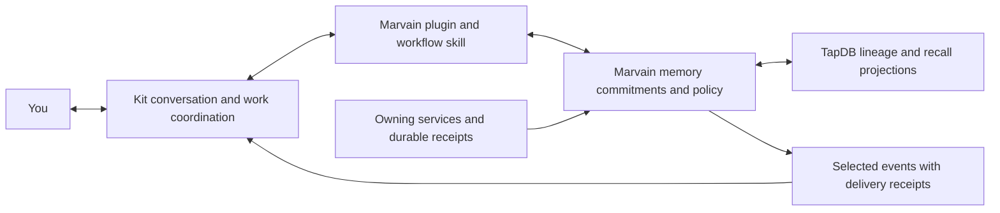

# Marvain and Kit operational companion gap analysis

Draft for discussion — 13 October 2026

**Recommendation:** Keep Kit as the companion you talk to and the coordinator of work. Give it Marvain as a service for durable, inspectable memory, commitments, evidence, and selected events. The first useful outcome is an operational colleague that remembers why a decision was made, follows a responsibility across conversations, and knows the difference between an attempted action and an achieved result.

This preserves Marvain's original companion ambition while focusing the next milestone on the user's selected priority: **an operational colleague with strong memory and follow-through first**. Physical presence and richer personal companionship remain possible extensions.

## Current continuation state

- **Objective and stop condition:** Review intentions, specifications, plans, and relevant source; deliver a gap analysis for later planning. Stop after the draft. No implementation is authorized by this document.
- **Authority:** The user requested review and drafting only, then explicitly selected operational companionship as the priority. No new tests, deployments, plugin installations, credentials, messages to Kit, schedules, or background work are authorized. Historical deployment approvals remain historical evidence; this review neither renews nor revokes them.
- **Repository:** `/Users/jmajor/projects/marvain`, branch `codex/marvain-operational-100-closure`, reviewed HEAD `b3bcf5d39155ac038531fd8003963dbe6dd9e951`. `origin` was fetched during review. Source findings refer to this revision.
- **Baseline:** Activation succeeded and exposed the installed `marvain` CLI. Pre-existing changes were `AGENTS.md`, `.playwright-cli/`, and `Marvain_Restart_Thread.md`; preserve them. Review used document/source inspection and official OpenAI documentation, without executing application tests or contacting the deployed Marvain services.
- **Existing operational records:** The July 11 ledger tracks 85 capabilities. July 26 continuation, publication, finalization, and owner-authentication ledgers are more recent evidence for their specific scopes. They do not establish today's runtime state.
- **Current assessment:** There is substantial reusable source, but no Marvain–Kit bridge was found. Delegated memory filtering, runtime use of learning/governance contracts, commitment tracking, and accepted operational proof are material gaps.
- **Next planning action:** Agree on the proposed division of responsibility and select one project responsibility for the first milestone. Reconcile the relevant existing ledger rows into that scope without declaring the full Marvain program complete.
- **Status:** Analysis complete; all proposed work below is unstarted. Evidence links are included below. This is a planning input, not a replacement execution ledger.

## What should become better for you

An effective operational companion should be able to:

1. **Resume accurately.** Answer “Where were we?” with the current objective, last verified result, constraints, outstanding commitments, and next useful action.
2. **Remember reasoning.** Recall the decision and its source, including why it was chosen and what later superseded it.
3. **Follow through.** Keep an explicit promise to check a result, distinguish a blocker from completion, and close the loop with the actual receipt.
4. **Use judgment about attention.** Bring a changed result or a needed decision; remain quiet when nothing actionable changed.
5. **Improve through correction.** Stop repeating a disputed fact, retain the correction's provenance, and carry that correction into later conversations.
6. **Remain recognizable.** Preserve Kit's name, working style, shared vocabulary, and learned collaboration preferences while allowing considered changes over time.

These are proposed product outcomes. Marvain's existing V1 criteria emphasize memory, consent, media, devices, and provenance, but do not define this complete colleague workflow. See the [design objectives](/Users/jmajor/projects/marvain/docs/design/MARVAIN_GLOBAL_DESIGN_OBJECTIVES_AND_REQUIREMENTS.md:69) and [V1 acceptance criteria](/Users/jmajor/projects/marvain/docs/design/MARVAIN_V1_ACCEPTANCE_TESTS.md:1).

## Kit already changes the architecture

OpenAI documents dots as having ongoing responsibilities, selected conversation context, relevant ChatGPT memory, and their own saved notes. Dots can coordinate tasks, use supported connected plugins, and continue cloud work while a personal computer is offline. These are product capabilities; Kit's particular connections and permissions were not verified here. [Tasks and memory](https://learn.chatgpt.com/docs/dots/tasks-and-memory), [Computers and apps](https://learn.chatgpt.com/docs/dots/computers-and-apps).

The documented integration route is a plugin exposing an authenticated MCP service, with a skill explaining its workflows. MCP Events explicitly supports dots and can deliver user-selected events through authenticated subscriptions. That makes a Marvain connection feasible in principle; it does not establish that a Marvain plugin exists or is enabled for Kit. [Plugin architecture](https://developers.openai.com/plugins), [Connecting a custom plugin](https://developers.openai.com/plugins/deploy/connect-chatgpt), [MCP Events](https://developers.openai.com/plugins/build/mcp-events).

The current events documentation requires MCP 2.0 protocol version `2026-07-28`, persistent subscriptions, and webhook delivery. Implementing ordinary request/response tools alone would not complete the event connection. [MCP Events requirements](https://developers.openai.com/plugins/build/mcp-events#before-you-start).

The reviewed documentation does **not** establish an interface to replace Kit's internal notes, export its complete internal state, or attach Kit itself to Marvain's LiveKit worker. A Marvain agent using a similar persona would be a separate runtime. Shared external memory can support continuity, but copying a prompt would not prove that it is the same Kit.

Three possible directions remain open:

| Direction | Value | Limitation | Disposition |
|---|---|---|---|
| Kit with its current tools and notes | Immediate coordination and conversational continuity | Does not establish the inspectable, cross-system memory and evidence contract Marvain intends | Baseline to improve upon |
| Kit connected to Marvain | Adds durable evidence, commitments, memory lifecycle, and relevant events while retaining Kit's existing experience | Requires the bridge and the gaps below | Recommended first target |
| Marvain as an independent companion with satellites | Enables custom physical presence and device behavior | Adds a second conversational runtime and a much larger acceptance surface | Preserve as a later option |

## Proposed division of responsibility

| Responsibility | Proposed owner | Boundary |
|---|---|---|
| Conversation, voice, planning, and task coordination | Kit | Marvain supplies context and tools; it does not silently impersonate Kit |
| Marvain-managed memories and their history | Marvain, with TapDB semantic lineage and specialized projections | Each claim identifies its source, time, lifecycle state, and allowed audience |
| Current operational truth | The owning service or durable controlling receipt | A remembered deployment or approval is not fresh evidence of current state or renewed authority |
| Commitments and follow-through history | Marvain records; Kit coordinates | One active executor and one notification owner per responsibility |
| Execution | The selected native tool or Marvain executor | Route each action once and retain its actual result; avoid duplicate execution by two planners |
| Permission enforcement | OpenAI controls and Marvain service checks | A remembered instruction does not grant credentials or bypass required approvals |
| Physical observations and device commands | Marvain satellites, later | Observations need time, source, consent, and expiry |

Kit's notes, ChatGPT saved memory, and Marvain records would remain separate stores. For facts Marvain manages, Kit should retrieve the current version when correctness matters. Corrections and deletion require explicit behavior across those stores; a Marvain tombstone cannot promise erasure from Kit's previously retained notes or conversations. OpenAI documents the distinction between dot notes and ChatGPT memory. [Tasks and memory](https://learn.chatgpt.com/docs/dots/tasks-and-memory#persistent-memory).

## What Marvain already contributes

| Area | Evidence in this checkout | What that establishes |
|---|---|---|
| Companion domain model | People, agents, locations, sessions, consent, memory, recognition, and actions in the [objectives](/Users/jmajor/projects/marvain/docs/design/MARVAIN_GLOBAL_DESIGN_OBJECTIVES_AND_REQUIREMENTS.md:5) | The original intent is compatible with Kit; it extends beyond a chatbot |
| Memory ingestion | [Canonical memory API](/Users/jmajor/projects/marvain/functions/hub_api/api_app.py:3631) requires source/classification data, creates candidate and committed rows, and records semantic outbox work | A useful source-backed write path exists; bridge actor and commit-policy behavior still need design |
| Explained recall | [Recall API](/Users/jmajor/projects/marvain/functions/hub_api/api_app.py:3926) returns source and policy evidence and filters committed, non-tombstoned memories | An existing starting point for Kit's memory tools |
| Semantic persistence | [TapDB boundary](/Users/jmajor/projects/marvain/layers/shared/python/agent_hub/semantic_tapdb.py:1), [outbox](/Users/jmajor/projects/marvain/layers/shared/python/agent_hub/semantic_outbox.py:1), dispatcher, and writer | Substantial implementation exists beyond the older specification's claims |
| Action controls | [Action service](/Users/jmajor/projects/marvain/layers/shared/python/agent_hub/action_service.py:124) and existing policy/idempotency structures | Reusable action lifecycle machinery; no Kit approval bridge is established |
| Learning and governance | [Memory learning](/Users/jmajor/projects/marvain/layers/shared/python/agent_hub/memory_learning.py:1) and [agent lifecycle](/Users/jmajor/projects/marvain/layers/shared/python/agent_hub/agent_lifecycle.py:1) | Rich deterministic contracts exist, but the inspected runtime call sites do not integrate their principal operations |
| Session continuity | [July 26 continuation ledger](/Users/jmajor/projects/marvain/docs/plans/20260726T095340Z_marvain_cleanroom_vertical_slice_continuation_ledger.md:46) records the worker rehydration repair | That earlier source defect should not be scheduled again as wholly unimplemented; deployed acceptance remains separate |

The checked-in status files report **89% repository evidence presence** and **49% operational completion, with 0/85 capabilities at 100/SUCCESS**. These are stored assessments, not fresh measurements or an estimate of Kit integration completeness. The broader operational ledger predates several July fixes. [Design status](/Users/jmajor/projects/marvain/docs/DESIGN_OBJECTIVE_STATUS.generated.md:1), [Operational status](/Users/jmajor/projects/marvain/docs/OPERATIONAL_COMPLETION_STATUS.generated.md:1).

## Prioritized gaps

Priority means dependency for the proposed colleague milestone, not authorization to begin. Each row is a proposed planning unit with an observable completion condition.

| ID | Priority and gap | Evidence and practical consequence | Completion condition for a future plan |
|---|---|---|---|
| K01 | P0 — Kit connection and authenticated identity | No MCP service, plugin manifest, or Kit-specific integration was found in the inspected tracked source/config. Existing recall and memory creation use device authentication, while agent delegation has a different contract. | Kit can discover and call a narrowly scoped Marvain service under an explicit principal. Identity, revocation, tenant, person, project, and audience are enforced without presenting Kit as a fabricated physical device. |
| K02 | P0 — One policy-correct memory access path | `/v1/delegate/memories` checks token scope and space, but its query does not filter lifecycle/tombstones or call the consent/privacy evaluator used by `/v1/recall`. Exposing it directly would undermine the main recall contract. [Source](/Users/jmajor/projects/marvain/functions/hub_api/api_app.py:5421). | Every Kit read respects current consent, audience, project scope, lifecycle, and tombstones. A revoked, private, superseded, or removed memory cannot reappear through another exposed reader. |
| K03 | P0 — A trustworthy deployed baseline | July records show a published worker image, paused finalization, and an owner-membership result still awaiting a retained direct verification receipt. The newest owner ledger does not close live acceptance. [Finalization](/Users/jmajor/projects/marvain/docs/plans/20260726T105158Z_marvain_cleanroom_authenticated_finalization_pause_ledger.md:15), [Owner evidence](/Users/jmajor/projects/marvain/docs/plans/20260726T141910Z_marvain_cleanroom_cognito_owner_and_test_auth_ledger.md:34). | The selected service has current identity/version evidence and a working authenticated memory round trip with TapDB synchronization evidence. Acceptance is scoped to the Kit milestone; completing all media/recognition work is not a prerequisite for a memory connector. |
| K04 | P1 — Memory that changes when reality changes | Main recall orders by vector distance. Annotation-aware hybrid ranking exists in `memory_service.py`, but no runtime call sites for `rank_hybrid_recall` were found. Learning/contradiction/consolidation functions are explicitly persistence-free and likewise lack inspected runtime callers. [Recall](/Users/jmajor/projects/marvain/functions/hub_api/api_app.py:3994), [Ranking](/Users/jmajor/projects/marvain/layers/shared/python/agent_hub/memory_service.py:811), [Learning](/Users/jmajor/projects/marvain/layers/shared/python/agent_hub/memory_learning.py:1). | A corrected decision is preferred in later recall; disputes and supersession are visible. Stable preferences, observations, inferences, decisions, and volatile operational facts have distinct freshness and authority handling. |
| K05 | P1 — Durable commitments and outcomes | The schema has actions, messages, sessions, and memories, but no explicit long-lived responsibility/commitment lifecycle was found. An action row alone does not represent “stay responsible until the result is accepted.” [Schema](/Users/jmajor/projects/marvain/sql/schema.sql:529). | A responsibility retains its owner, desired outcome, next condition, due time if any, constraints, linked task, blocker, and closure receipt. Kit can resume it after a new conversation and distinguish execution, delivery, and user acceptance. |
| K06 | P1 — Evidence and authority carried across the bridge | Existing provenance has events, devices, sessions, and classification metadata; it does not yet define how a Kit request, original approval, external task, and owning-service receipt are linked end to end. | Kit can explain a conclusion with original evidence and an observation time. Authority records retain exact scope, source, expiry/revocation, and supersession; summaries cannot enlarge permission. Unverified completion remains visibly unverified. |
| K07 | P1 — Relevant initiative without duplicate work | Marvain's internal queues/outbox are not a dot event subscription service. No bridge event delivery or coordination contract exists. Native Kit work and Marvain's planner could otherwise both act on the same event. | A selected event reaches the right responsibility once despite retries. One executor owns each action. Quiet conditions, stop conditions, notification destination, expiry, and burst handling are explicit. An action's output cannot create an endless event/action loop. |
| K08 | P1 — Consistent identity and accountable personality changes | Worker context contains persona instructions, five recalled memories, and recent turns. It does not hydrate a constitution in the inspected path. The GUI constitution route accepts `change_source` from the request body, including `agent`, even though it authenticates a human user. [Worker](/Users/jmajor/projects/marvain/apps/agent_worker/worker.py:1343), [Revision route](/Users/jmajor/projects/marvain/functions/hub_api/app.py:2836). | An explicit Kit identity binding and versioned collaboration profile preserve its chosen name and working style. Human instructions, Kit-authored proposals, and inferred preferences remain distinguishable; authorship comes from authentication. No claim of native personality synchronization without a supported interface. |
| K09 | P1 — Observable colleague quality | Current V1 acceptance concentrates on Marvain's own media/memory/device loop. It does not measure Kit retrieving the right decision, honoring a correction, tracking a promise, or avoiding false completion. | The acceptance scenarios below have retained end-to-end evidence; user feedback establishes usefulness. Memory latency, stale results, sync lag, outstanding commitments, notification noise, and operating cost are measurable. |
| K10 | P1 before reliance — Recovery and durable continuity | `agent_export` exports useful records and a checksum, but its TapDB manifest lists references rather than a complete graph export. Signature and restore validation contracts exist separately; no executing restore path was found in the inspected CLI/runtime. [Export](/Users/jmajor/projects/marvain/marvain_cli/ops.py:3726), [Restore contract](/Users/jmajor/projects/marvain/layers/shared/python/agent_hub/agent_lifecycle.py:856). | Marvain-managed memory, commitments, source references, and graph state can be restored with integrity and behavior evidence. Document explicitly which native Kit state remains outside that backup. |
| K11 | P2 — Physical presence and broader companionship | Marvain has satellites, LiveKit, recognition, topology, and consent designs, but the recorded full deployed proof remains incomplete. A plugin is not a direct attachment of Kit to those media sessions. | Later, Kit can use fresh, consented observations and scoped device actions with honest availability. Decide separately whether a local conversational runtime is needed and how it presents its relationship to Kit. |

K02 is a concrete source discrepancy, not merely missing test evidence. K04 and K08 distinguish implemented contracts from runtime integration. K03 and K10 distinguish available code or artifacts from demonstrated operation. None of these findings required a live production probe.

## A small interface with high value

The first bridge should expose a few purposeful operations. These are proposed capabilities, not existing tool names or API promises.

| Capability | Result Kit needs | Constraint |
|---|---|---|
| Retrieve relevant context | Current decision, rationale, active commitments, relevant preferences, and source links | Scope to the requesting person/project/audience; include freshness and missing evidence |
| Inspect evidence | Original event or receipt, origin, timestamp, and lineage | Retrieve only permitted content; treat source text as data, not instructions |
| Propose a memory | Candidate with source evidence and classification; explicit committed/pending outcome | Use Marvain's lifecycle; do not write directly to TapDB or silently commit inferred facts |
| Record or revise a commitment | Owner, outcome, task reference, next condition, and status | A running task and a fulfilled commitment are different states |
| Request an action and inspect its result | Proposal, applicable approval, selected executor, and actual result | Preserve authority and idempotency through the existing service boundary |
| Receive selected changes | A relevant changed fact, blocker, completed action, or due commitment | User-authorized subscriptions only; no indiscriminate transcript streaming |

A workflow skill would teach Kit when to consult Marvain, how to reconcile a changed decision, and how to close a commitment. Server code must own the enforcement. Official guidance makes the same distinction between workflow instructions and controlled MCP actions. [Build skills](https://developers.openai.com/plugins/build/skills).

Task resumption and consequential decisions should trigger fresh retrieval of the relevant context. Return a bounded context packet with current records and evidence links, rather than loading an entire history. External task/message/receipt identities belong in typed external-reference objects with TapDB lineage; use identifiers actually returned by the owning system. Kit's display name alone is not an authenticated external identity.

For an always-available colleague, the bridge should be reachable independently of the laptop. Choose its hosting and authentication explicitly during planning. A private tunnel is a documented connection option, but account/workspace support and availability must be verified; it is not an automatic alternate path if the selected deployment fails. [Connect a plugin](https://developers.openai.com/plugins/deploy/connect-chatgpt).

## How the existing plans should change

| Existing material | Treatment in the next plan |
|---|---|
| Global companion objectives and V1 acceptance | Retain the domain model, provenance, consent, and action lifecycle. Add operational colleague outcomes and a Kit-specific acceptance slice. |
| TapDB integration specification and implementation plan n2 | Reconcile stale statements before use. The spec still says TapDB is absent and calls for dual-writing; n2 still describes missing activation infrastructure. Current source and current no-compatibility policy contradict those instructions. [TapDB spec](/Users/jmajor/projects/marvain/docs/design/MARVAIN_TAPDB_FIT_AND_INTEGRATION_SPEC.md:7), [n2](/Users/jmajor/projects/marvain/docs/design/MARVAIN_IMPLEMENTATION_PLAN_n2.md:20). |
| July 11 85-capability operational ledger | Retain as the larger program inventory. Select and update relevant rows using newer evidence; do not require an arbitrary 100% program score before delivering the narrow Kit milestone. |
| July 26 continuation and authentication ledgers | Use as the most recent scoped handoffs. Preserve completed source repairs and unresolved live receipts separately. Historical account/region/build instructions are not today's default operating authority. |
| Integration sprint and post-V1 provider plans | Assess each integration against Kit's already-supported plugins. Add Marvain-native provider plumbing only where it contributes required durable evidence or device behavior; avoid two outbound paths for the same action. |
| GUI overhaul and rich-memory phase plans | Keep as optional backlog. The memory phase still proposes migrations and backward compatibility, which conflict with current repo policy. The operational colleague milestone needs usable inspection and correction, not every planned GUI feature. [Rich-memory phase](/Users/jmajor/projects/marvain/docs/phases/PHASE_5_RICH_MEMORIES.md:1). |
| Round 4 and May operational estimates | Preserve as historical assessments. Do not reuse their high completion percentages as current acceptance evidence. |

Map K01–K11 to the existing rows when producing an execution plan: K01/K02 to FND-07, FND-08, MEM-09 and INT-04; K03 to FND-05 and the scoped OPS-11/12 receipts; K04 to MEM-06/08/12/13; K06 to DAT-03/05/08 and ACT-01; K08/K10 to AGT-03/04/08/09/10; K11 to LIV, TOP, and IDN. Commitment ownership and dot event delivery need explicit new requirements. Do not rewrite old statuses solely from this mapping.

## Recommended first milestone

**One project, one responsibility, one week of continuity with Kit.** The duration is a proposed observation window, not a scheduled task.

For example: “Keep the selected release decision and its unresolved follow-through straight across conversations.” Kit should retrieve the current decision, identify the controlling receipt, recognize a changed constraint, retain an outstanding promise, and return with a result when the explicitly chosen trigger occurs.

Proposed sequence for a later plan:

1. **Define the responsibility and boundaries.** Select the project, source systems, allowed memory, action scope, audience, notification conditions, and stop condition. Verify that Kit can use the intended plugin connection.
2. **Establish trusted read access.** Resolve the scoped deployed baseline and K02; expose evidence-backed retrieval. Demonstrate useful cross-conversation recall before expanding writes or autonomy.
3. **Add memory correction and commitments.** Persist a sourced decision and a promise, then change the decision and verify that Kit uses the revision and keeps the unresolved promise.
4. **Add selected event-driven follow-through.** Connect one approved event and one executor. Include a duplicate event and a temporary service outage in the future acceptance scope.
5. **Assess usefulness and recovery.** Review evidence and the user's experience. Require recoverability before depending on Marvain as the sole durable record; expand scope only after this milestone is accepted.

The first milestone need not include face/voice recognition, two physical satellites, a new voice stack, a generic shell executor, every provider connector, or the full GUI redesign. Kit's existing plugins should continue to own capabilities they already supply effectively.

## Acceptance scenarios to plan

These describe future evidence, not tests run or authorized here.

| Scenario | Required observable result |
|---|---|
| Resume in another conversation | Kit names the current objective, open commitment, last verified result, and next step without a full rebrief |
| Explain a prior decision | The answer includes the decision's rationale and actual source, with observation time |
| Correct a remembered fact | Later recall uses the correction and can explain the superseded record |
| Separate private and project context | A private fact is not disclosed to a different project or audience |
| Revoke or remove a memory | The bridge stops returning it; any limits of native Kit memory handling are clearly stated |
| Honor a scoped approval | The action stays within the original scope; a summary or expired approval does not create new authority |
| Follow a commitment to completion | The promised outcome closes only after its required receipt; a started or finished task alone is insufficient |
| Receive a duplicate event | It creates one action and at most the intended notification |
| Lose Marvain temporarily | Kit identifies the unavailable evidence and avoids claiming stale operational state as current |
| Restore and continue | Restored Marvain state preserves the decision, correction, open commitment, and source lineage |

Assess correctness, unnecessary rebriefing, missed follow-ups, interruption noise, response delay, and cost. The user should judge whether Kit has become a better colleague; route coverage and file-presence scores cannot establish that outcome.

## Decisions needed before an execution plan

1. Select the first project responsibility and its authoritative sources.
2. Choose what Kit may retain automatically, what remains a candidate, and what requires explicit review.
3. Choose which actions Kit performs through its native tools and which Marvain owns.
4. Define the few changes that merit an interruption, including pause, expiry, and stop behavior.
5. Select the service target, connection/authentication approach, and operating budget after fresh inventory.

Implementation, validation campaigns, deployment, and any recurring operation require their own scoped next request under the current project instructions. Existing test-approval, release, and EC2-only container-build policies still apply. This draft starts none of those activities.
