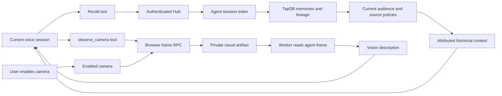
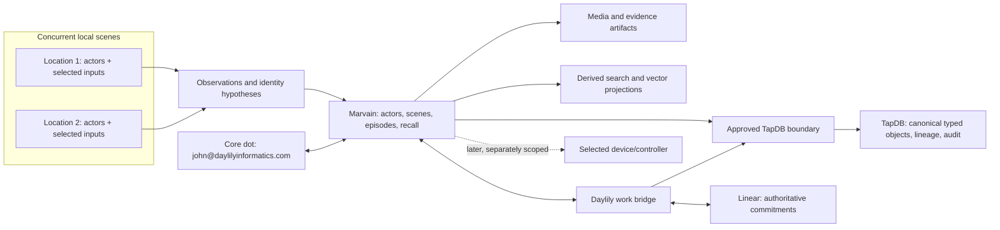
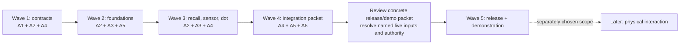

# Marvain 4.x — multi-agent execution plan

**Revision:** 1  
**Prepared:** 9 November 2026  
**Status:** Hub/responder 4.0.14 deployed successfully; cross-session recall accepted. Spoken camera repair awaits attended acceptance. Recognition image remains 4.0.9.

## Current continuation state

10 November 2026: interactive repair ACTIVE. User accepted cross-session recall (“this works great”) and reports camera preview stays on but agent says it cannot see. Source confirmed only typed chat received visual descriptions; 4.0.14 now supplies a fresh-frame voice tool. Chrome page reloaded with laptop selected, disconnected and ready for the user. Stop condition: tagged fixes deployed and attended recall/camera/recognition results recorded. User controls capture/consent. No automated suite, lint, CI, PR/merge, destructive cleanup or local container builds.

Workspace /Users/jmajor/.codex/worktrees/marvain-interactive-resume/marvain; branch codex/marvain-interactive-resume. Published source 0b0bf80 / annotated tag 4.0.14; prior tags 4.0.13 (662161c) and 4.0.12 (3de4989). Preserve original checkout's unrelated local files. Target lsmc / 108782052779 / us-east-2 / marvain4-prod; config /Users/jmajor/.config/marvain/marvain-lsmc-us-east-2.yaml. Hub/responder 4.0.14 deployment returned exit 0; recognition image 4.0.9. Builder i-0325430bfec70e41e stop accepted (running → stopping), last IP 18.225.55.12. Resolve its current IP through owning lifecycle command after restart.

Completed: 4.0.12 fixed missing boto3/S3 permission and explicit vision model/bucket/agent artifact scope; canonical recall searches authorized agent sessions with attributed startup context and recall tool; model evidence quotes come from source text. Worker log CLI and SAM error propagation fixed. 4.0.13 targets the committed scene outbox row through existing dispatcher leases/retries and disconnects media before final uploads finish. Existing schedule unchanged. Receipts /Users/jmajor/.codex/worktrees/marvain-interactive-resume/marvain/build/releases/4.0.12/ and /Users/jmajor/.codex/worktrees/marvain-interactive-resume/marvain/build/releases/4.0.13/. Join/Leave timing acceptance pending new page load.

Attended evidence: session 1badf345-7fdc-4682-a38a-5c189ea2630f recorded a marker; c14ea07a-2435-4339-aeaa-3bfd4e30d477 correctly recalled it at 20:31:19 ET, user accepted. Initial hydration had 15 memories. One classifier provider request failed at 20:28:54; other captures succeeded. At 20:41:14, camera frame analysis succeeded and browser acknowledged it, but voice agent lacked the observation. Recall test source and manifest extended, not executed.

Released 4.0.14 adds observe_camera as a LiveKit function tool and marvain.camera_frame browser RPC. A spoken visual question requests a fresh frame only from the enabled camera in the bound session, then reuses existing artifact analysis/persistence and returns the description to the voice model. No continuous sampling, automatic camera activation or identity inference. Official contract https://docs.livekit.io/transport/data/rpc/. Final EC2 build tmux marvain-4-0-14-release returned exit 0; artifact transfer/extraction and deployment returned exit 0; builder stop accepted. Receipts /Users/jmajor/.codex/worktrees/marvain-interactive-resume/marvain/build/releases/4.0.14/. Chrome reloaded, laptop selected. Pending user question: Join, enable Camera, ask aloud what is visible, change the view and ask again; also report Join timing. Next: record camera result, then camera-off and explicit voice/face enrollment checks. Voice/face enrollment/recognition, DAY-22 second login binding and two-location demo remain incomplete; DAY-142 Active.

## Interactive recall and camera repair — 10 November 2026

| ID | Requirement | Status | Owner | Evidence / next action |
|---|---|---|---|---|
| WP-25 | Repair past-session recall | SUCCESS | A0 | Source and deployment 4.0.12 complete; attended behavior tracked separately in WP-28. |
| WP-26 | Repair camera analysis | SUCCESS | A0 | Source and deployment 4.0.12 complete; attended camera behavior tracked in WP-28. |
| WP-27 | Preserve grounded memory extraction | SUCCESS | A0 | Deployed source quote selection through Structured Outputs enum; no deterministic fallback or relaxed grounding. Live capture acceptance remains WP-28. |
| WP-28 | Attended continuity and linked recognition | IN_PROGRESS | John + A0 | Cross-session recall accepted by John on 4.0.12; preview/analysis work but spoken camera use failed and is being repaired in WP-30. Explicit voice/face enrollment and separate identity checks remain. |
| WP-29 | Prompt Leave and Join | IN_PROGRESS | A0 | Hub-only 4.0.13 deployed successfully; immediate outbox dispatch and prompt media disconnection implemented. User timing acceptance pending new page load. |

| WP-30 | Fresh camera observations in spoken conversation | SUCCESS | A0 | observe_camera function tool and enabled-camera browser RPC deployed in 4.0.14; attended acceptance remains WP-28. |

Recall remains lexical topic search with recent-memory startup context; wider Codex/Daylily ingestion is separate. Prior assistant statements remain attributed historical text, not current system instructions or evidence of user approval. Full-source policy/retention/correction rules remain in force. Cross-session recall does not grant a wider audience.

Implementation references: LiveKit function tool documentation https://docs.livekit.io/agents/logic/tools/definition/ and OpenAI Structured Outputs https://developers.openai.com/api/docs/guides/structured-outputs. No automated tests, lint or CI were run. Existing successful voice interaction and reported defects are the attended baseline.

4.0.12 publication/deployment receipt: source 3de4989, immutable annotated numeric tag pushed with feature branch. Worker image 108782052779.dkr.ecr.us-east-2.amazonaws.com/marvain4-prod-release-prerequisites-workerrepository-fdisivyobf3k@sha256:640f1e1c1525309069a2fc5533a134cd7d796fe3c67cf11241a4c84bdea57eaa. EC2 build tmux returned exit 0; SAM build and image publisher succeeded. Owning deployment returned exit 0 and stack success. No test suite, lint, CI, PR, merge or extra QC. Builder stop returned stopping; no additional completion gate was added. Requested live acceptance remains pending.

## Historical workspace and recognition checkpoint

10 November 2026 workspace change: John explicitly requested a new working directory because the old attachment is missing. The owning Codex create_worktree operation completed and attached /Users/jmajor/.codex/worktrees/marvain-interactive-resume/marvain from committed 663861b. Current branch is codex/marvain-interactive-resume. Use this workspace for subsequent source work; /Users/jmajor/projects/marvain retains the prior checkout, local notes and build receipts. No uncommitted files were moved or deleted. Production/config identities are unchanged. The LSMC Chrome profile (Profile 10, johnm@lsmc.com) was explicitly launched on the laptop Live Session URL; voice-result feedback remains pending.

10 November 2026 interactive resumption: John requests “lets start testing again” and asks to boot Marvain for interaction from the stopping point. Owning browser-activation worker-status returns desired=1, running=1, pending=0 (registration-log result empty); owning Hub activation status responds successfully with status=written for operation 5c72279f-fdba-41ec-a01d-51387dfc6d06 and the existing INITagent/laptop bindings. No service restart or redeployment was needed. macOS open returned exit 0 for Chrome People and laptop Live Session URLs. Human Join/microphone/“Hello Marvain” feedback is pending via the current question. This resumes attended product interaction; the automated acceptance suite has not run. Next: handle the user's actual voice result, then user-controlled voice/face consent, capture and enrollment review.

10 November 2026 worktree investigation: the chat attachment /Users/jmajor/.codex/worktrees/tapdb-marvain-auth-7-0-13/daylily-tapdb is missing. Both repositories' existing ledgers record that delayed checkout as unused; the TapDB repair was published through GitHub before it appeared. Current remote refs confirm TapDB tag 7.0.13 at fd4803f9bb1df463b5cc7129fceeeb10d2f24acf and its receipt commit 0c441eaefa903931d08909f33074d557dcaa47c2. Marvain remote branch matches local 916234479bcb423bfd7dd8488a14181e892d1e40, with tags 4.0.9/4.0.10/4.0.11 present. No unique source work needing recovery was identified. Remaining local files and the limited cause evidence are recorded below. No checkout was recreated or removed.

10 November 2026: scoped recognition repair is deployed. User requested linked voice/face identity, selected private-memory export and sensitive action approvals for corroboration, asked for obsolete-code cleanup and a progressive Chrome voice acceptance test, and chose AWS Rekognition paid per use (call_5b4993a15d634b4098309d53404c6193). Writing the test is authorized; running it is not. No capture or enrollment was performed.

Repo /Users/jmajor/projects/marvain; branch codex/marvain-operational-100-closure. Gate 0 was 1fd4596/tag 4.0.8, production Hub 4.0.7/responder 4.0.3. Current target is lsmc/account 108782052779/us-east-2/marvain4-prod; config /Users/jmajor/.config/marvain/marvain-lsmc-us-east-2.yaml. Preserve unrelated AGENTS.md, .playwright-cli and Marvain_Restart_Thread.md. No tests, lint, PR/merge, destructive cleanup, automatic capture or local container builds.

WP-22 COMPLETE (implementation/publication): canonical reviewed enrollment, retained voice vectors, AWS face reference comparison, one-person lineage across modalities, preserved consent identities, fresh one-use account/browser/operation-bound checks, scoped private-memory export and central sensitive human approval enforcement. Cognito/account permissions remain authoritative; biometric matching makes no liveness claim. Obsolete direct embedding/artifact-key enrollment and direct review/projection mutation paths are removed. Existing policy-driven automation retains its controls.

WP-23 COMPLETE (deployment): source 2762ca0/tag 4.0.9; Hub 36603f1/tag 4.0.10; orchestration-only fix becf77e/tag 4.0.11. Tags are annotated, immutable and pushed. Both EC2 build jobs returned exit 0. The owning operational migration returned exit 0; an initial invalid init-db command failed before mutation. SAM initially rejected a missing image-repository mapping before stack changes. CLI 4.0.11 supplies that mapping from the explicitly selected image URI. Deployment retry returned exit 0 and “Successfully created/updated stack - marvain4-prod in us-east-2.” Hub is 4.0.10, voice image 4.0.9, responder unchanged 4.0.3; no image rebuild for the CLI correction. Builder i-0325430bfec70e41e is stopped by its owning lifecycle result.

Published voice image: 108782052779.dkr.ecr.us-east-2.amazonaws.com/marvain4-prod-release-prerequisites-recognitionrepository-vugm3iqyf4za@sha256:c47ef2d88eb71b4ba64f610227f6613d3054b0e3ce7eaf430b80f84e4cf916fc. Logs: /Users/jmajor/projects/marvain/build/releases/4.0.9/ and /Users/jmajor/projects/marvain/build/releases/4.0.10/; controlling deployment receipt is deploy-with-image-repository.log in the latter directory. No redundant health or storage QC was added.

WP-24 COMPLETE (test source only): /Users/jmajor/projects/marvain/tests/acceptance/test_marvain_journey.py, README.md and marvain_journey.json record sign-in/MFA, prepared activation receipts, real Chrome Join/microphone/speech, human-confirmed audible reply, and Leave. Written, not run. Historical acceptance remains John’s “Connected and Marvain responds” on Hub 4.0.7/responder 4.0.3.

Next user step: https://1kuwpk5zj7.execute-api.us-east-2.amazonaws.com/prod/people → John → Consent → enable intended voice/face grants, then Enroll in laptop and review the resulting enrollment proposals. Read-only People-page observation shows John has recording consent but no voice/face grants. No consent was granted on his behalf. Live identity matches, conflict/revocation behavior, exports/approvals, dogs, later-session recall and WP-16/17 two-location demonstration remain unaccepted. DAY-142 stays Active; DAY-22 second-login linking remains outstanding. Implementation task is complete; broader Marvain demonstration is not.

## Missing-worktree investigation — 10 November 2026

User asked whether the missing current working directory requires work rescue and whether everything was committed. Gate 0: Marvain local 9162344 on codex/marvain-operational-100-closure; TapDB primary checkout /Users/jmajor/projects/daylily/daylily-tapdb on jem-dev at 12351b8. The app attachment still names the absent TapDB worktree and exposes no archived-worktree attachment. Git no longer lists that checkout; its surviving worktree metadata/reflogs contain no matching path. No cleanup, restore, reset, prune, merge, tests, build or deployment was performed.

| Investigation | Result | Evidence / boundary |
|---|---|---|
| Marvain published work | SUCCESS | Exact GitHub branch head matches local 916234479bcb423bfd7dd8488a14181e892d1e40. Release tags resolve to 2762ca0 (4.0.9), 36603f1 (4.0.10), and becf77e (4.0.11). These include the new recognition implementation, progressive acceptance test source and deployment receipts. |
| TapDB published repair | SUCCESS | GitHub tag 7.0.13 resolves to fd4803f9bb1df463b5cc7129fceeeb10d2f24acf; branch codex/marvain-auth-7-0-13 additionally contains 0c441eaefa903931d08909f33074d557dcaa47c2, which records publication/deployment receipts. The owning Git fetch succeeded. |
| Missing-checkout recovery | NO_LONGER_NEEDED for this work | Both committed ledgers explicitly record the delayed 7.0.12 checkout as unused; the actual repair was published separately. No unique source loss was identified. This does not prove that no unrecorded external edits ever occurred. |
| Remaining local material | SUCCESS inventory, preserved | /Users/jmajor/projects/marvain/AGENTS.md has 21 lines of user policy/shell guidance; /Users/jmajor/projects/daylily/daylily-tapdb/AGENTS.md has 14 lines of user release policy. /Users/jmajor/projects/marvain/Marvain_Restart_Thread.md is an untracked 24 July historical handoff. /Users/jmajor/projects/marvain/.playwright-cli/ contains 13 untracked July browser snapshots. These were intentionally excluded from the release and remain on disk. TapDB's two existing stashes concern older unrelated May work. |
| Cause attribution | SUCCESS bounded investigation | Codex log /Users/jmajor/Library/Logs/com.openai.codex/2026/11/10/codex-desktop-04cc0d8b-2141-4f23-83c3-feeacc2d0807-76666-t0-i1-000111-2.log records spawn_failed for the missing directory at 02:03:17 EST. The inspected 9–10 November logs do not establish a deletion/archival cause. No unsupported attribution to automatic cleanup. |

Conclusion: all implementation and release/receipt work from this Marvain effort is committed and pushed; not every local file is committed. The stale chat attachment remains an application workspace issue. Continue explicit Marvain commands from /Users/jmajor/projects/marvain. Historical July restart warnings do not describe today's source or deployment.

## Recognition amendment preparation — superseded by deployed receipt

10 November 2026: active scoped amendment. User requested recognition repairs, linked voice/face identity, and selected private-memory export and sensitive action approvals for extra identity corroboration. User also requested removal of obsolete code and a progressive test covering the successful Chrome voice journey; writing that test is authorized, running it is not. User explicitly chose AWS Rekognition paid per use in question call_5b4993a15d634b4098309d53404c6193. No pause is active for this amendment.

Gate 0: /Users/jmajor/projects/marvain, codex/marvain-operational-100-closure, 1fd4596/tag 4.0.8. Production remains Hub 4.0.7 and responder image 4.0.3. LSMC account 108782052779, us-east-2, stack marvain4-prod; config /Users/jmajor/.config/marvain/marvain-lsmc-us-east-2.yaml. Preserve unrelated AGENTS.md, .playwright-cli and Marvain_Restart_Thread.md. No tests, lint, PR/merge, destructive changes, automatic capture, or local container builds.

WP-22 SOURCE_PUBLISHED: source replaces obsolete direct enrollment/GUI review writes with the canonical recognition repository; retains voice vectors; creates reviewed voice/face projections with shared person lineage; preserves unchanged consent grants; uses AWS Rekognition single-face reference images instead of synthetic embeddings; adds fresh one-use account/browser/operation-bound corroboration and private scoped memory export. Human action approval is gated centrally; existing explicit automation policies retain their authority. Model scores are corroboration, not liveness or a substitute for Cognito.

WP-23 IN_PROGRESS: recognition ECR storage added through the owning prerequisite-stack update, UPDATE_COMPLETE. Source 2762ca0/tag 4.0.9 and 36603f1/tag 4.0.10 are pushed. Both final EC2 packaging jobs returned exit 0. Voice image 4.0.9 is published at 108782052779.dkr.ecr.us-east-2.amazonaws.com/marvain4-prod-release-prerequisites-recognitionrepository-vugm3iqyf4za@sha256:c47ef2d88eb71b4ba64f610227f6613d3054b0e3ce7eaf430b80f84e4cf916fc. Operational migration /Users/jmajor/projects/marvain/sql/migrations/20261110_120000_recognition_embedding.sql applied through marvain init db, exit 0. The first init-db spelling was rejected before mutation. RecognitionAgentId is configured to INITagent. Builder i-0325430bfec70e41e is running at 3.128.198.47. Evidence is in /Users/jmajor/projects/marvain/build/releases/4.0.9/ and /Users/jmajor/projects/marvain/build/releases/4.0.10/. Next: finish artifact transfer, deploy the prebuilt 4.0.10 Hub with final 4.0.9 voice image, record the owning result, and stop builder. Hub runtime is still 4.0.7. Recognition acceptance requires user-controlled capture afterward.

Final Hub source correction: the original browser activation's persisted recording grant lacks canonical grant lineage. The consent editor now materializes that actual grant on its first edit before linking a revocation. Identity-check audit now links a typed external reference for the exact target operation. This becomes immutable Hub release 4.0.10; the unchanged final voice image remains 4.0.9 and the responder remains 4.0.3. No image rebuild is needed for this Hub-only correction. No application deployment has run yet.

Deployment attempt: SAM rejected the missing --image-repositories mapping at argument parsing, before stack changes. Receipt /Users/jmajor/projects/marvain/build/releases/4.0.10/deploy.log. The Marvain deployment CLI now passes RecognitionVoiceFunction mapped to the repository in the explicitly configured published image URI. Hub package 4.0.10 and voice image 4.0.9 are unchanged; this orchestration-only fix requires no rebuild. Builder stop returned stopping, then its owning lifecycle returned stopped. Retry the existing prebuilt deployment after publishing the CLI correction.

WP-24 SOURCE_WRITTEN: /Users/jmajor/projects/marvain/tests/acceptance/test_marvain_journey.py and marvain_journey.json preserve the accepted Chrome path. Real sign-in/MFA, microphone, speech, audible-response human confirmation and Leave are explicit. The test consumes setup success receipts and does not reprovision resources or claim unaccepted features. No test has run. Historical voice acceptance remains John’s “Connected and Marvain responds,” not a new test result.

## Historical 4.0.8 and first conversation checkpoint

Active amendment, 10 November 2026: John resumes work with “please make the fixes you find are needed” and requests linked voice/face identification for one person plus an additional identity check for sensitive operations. He explicitly selects **private-memory export and sensitive action approvals** for enforcement. Gate 0 is 1fd4596/tag 4.0.8 on codex/marvain-operational-100-closure in /Users/jmajor/projects/marvain; production baseline Hub 4.0.7/worker 4.0.3. Preserve unrelated local instructions/browser artifacts/restart notes. Tests remain off; no PR/merge or destructive changes. This supersedes the overnight pause for the scoped repair only.

Observed defect: hosted Recognition page queries missing recognition_observations.model. Source inspection also finds GUI enrollment/review routes using obsolete columns and bypassing the existing recognition repository. WP-22 IN_PROGRESS: repair enrollment/review/readiness through the current service and schema; retain voice and face under the same person and canonical actor lineage; implement account-bound, fresh, session-scoped identity corroboration for the two selected sensitive operations, with mismatches/unknowns visible and no biometric-only grant of authority. WP-23 OPEN: publish/deploy the scoped release through the designated EC2 build workflow and activate the recognition path using explicit model/worker configuration. Next: inspect the existing repository/lifecycle/policy interfaces and reuse them rather than introducing a second identity store.

Git release checkpoint, 9 November 2026: John requested “commit and oush this all to. anew tagged git release” after accepting the overnight pause. Numeric annotated release 4.0.8 captures the completed implementation, deployment receipts, successful first voice interaction and cost/pause handoff on codex/marvain-operational-100-closure. The application source is unchanged from deployed 4.0.7; this publication does not build or deploy anything. Tests, PRs and merges remain off. Existing unrelated local instructions, browser artifacts and restart notes remain outside the release scope.

WP-21 is SUCCESS for the first Mac/Chrome voice endpoint and AWS responder. John replied **“Connected and Marvain responds”** to the Join/microphone/“Hello Marvain” handoff question (call_bca08cf48165486795cf52a68a0d3c39). This direct user result is the conversation acceptance receipt. Camera perception, raw-recording persistence and later-session recall are not separately accepted by that statement. WP-16/17 two-location multi-actor demonstration and physical interaction remain unfinished; DAY-22 second-login binding also remains outstanding.

Immutable annotated release 4.0.7 at 1817801 is deployed to lsmc/account 108782052779/us-east-2/marvain4-prod. Exact tagged EC2 packaging, artifact transfer/extraction, source deployment and worker-count deployment returned exit 0. Worker image remains 4.0.3; desired=1/running=1/pending=0 and LiveKit registration AW_FviJFqCZqeWG (forge) were returned at activation. Dot remains disabled. Builder i-0325430bfec70e41e lifecycle reports stopped. 4.0.6 was built but never deployed; 4.0.7 adds required binary-media transport using ApiDeploymentVersion=2.

Browser activation 5c72279f-fdba-41ec-a01d-51387dfc6d06 reports written and bound, binding secret version 6cc48ff5-6a41-49b4-a49e-76565b96b7ba. The first graph attempt hit dependency ordering; existing SQS retry completed it normally. Reused INITagent d0424328-aa35-4a62-b2d6-46808c0ead1f and laptop 6375476a-8498-49a0-8a7d-98722392de34 for owner johnm@lsmc.com/person John. Worker device 42db7736-67a5-4fa2-b598-4ef9adbefa43 and browser device cabc0d0f-0bff-41f6-be8e-81cb07c5937e are separate from the user's existing physical device.

Authority: user selected this Mac/Chrome, approved private retain-all with “you can store is all,” and requested “can you step through and get this working pleaee.” Capture remains controlled by user Join/mic/camera. No tests, extra QC, PR/merge, new monitor, Dot activation or physical satellite installation. Existing objects and policies remain intact. Prior source-only boundaries are superseded only within that requested activation.

Repo /Users/jmajor/projects/marvain, branch codex/marvain-operational-100-closure. Config /Users/jmajor/.config/marvain/marvain-lsmc-us-east-2.yaml. Evidence /Users/jmajor/projects/marvain/build/releases/4.0.7/. Preserve unrelated AGENTS.md, .playwright-cli and Marvain_Restart_Thread.md work. Work is PAUSED for the night at the user’s explicit request. The final requested task is an overnight cost estimate; no resource shutdown or teardown is authorized. Resume implementation only on further user instruction.

## Overnight cost estimate — 9 November 2026, 23:23 ET

User confirms first voice response, then explicitly pauses work for the night and requests cost information before deciding whether to stop/tear down anything. No infrastructure changes were made for this estimate. Live resource inventory and Ohio AWS Price List API responses are retained in /Users/jmajor/projects/marvain/build/releases/4.0.7/cost-runtime.json and /Users/jmajor/projects/marvain/build/releases/4.0.7/cost-prices.json.

| Component | USD/hour estimate |
|---|---:|
| Aurora PostgreSQL serverless v2, 0.5 ACU idle × $0.12 | 0.06000 |
| Fargate responder, 1 x86 vCPU + 2 GB | 0.04937 |
| One NAT gateway | 0.04500 |
| Secrets Manager interface endpoint in two AZs | 0.02000 |
| Two public IPv4 addresses, NAT and responder | 0.01000 |
| Stopped builder's 100 GB gp3 disk, $8/month ÷ 730 | 0.01096 |
| Known fixed subtotal | 0.19533 |

Allow approximately $0.20–$0.25/hour for idle AWS, including a rough allowance for secrets, alarms, retained storage and light serverless use: $2.40–$3.00 for 12 hours. This is a list-price estimate before credits/tax, not a metered invoice or hard cost cap. Aurora ranged 0.5–2 ACU during the observed hour, average 0.53; if held at its configured 2 ACU maximum, compute adds $0.18/hour. Dot has no running compute resource; the EC2 builder is stopped but its disk remains billed. No object-listing/checksum or redundant verification was performed.

The idle estimate assumes the user clicks Leave to end the live session and capture. It excludes any existing LiveKit subscription, whose actual plan was not inspected, and usage from ongoing conversations/media. OpenAI gpt-realtime is configured; inference is usage-based, not an idle worker fee. Recommendation: leave the session and retain the deployment overnight. Scaling the responder to zero would save about $0.05437/hour including its public IP, or $0.65/12 hours; no shutdown was performed.

Public price sources: https://aws.amazon.com/fargate/pricing/ ; https://aws.amazon.com/rds/aurora/pricing/ ; https://aws.amazon.com/vpc/pricing/ ; https://aws.amazon.com/privatelink/pricing/ ; https://aws.amazon.com/ebs/pricing/ ; https://developers.openai.com/api/docs/guides/voice-latency-cost ; https://livekit.com/pricing . Exact regional compute/storage rates are from the AWS Price List API receipt above.

## Historical activation preparation and policy selection

Policy decision, 9 November 2026: in response to the proposed private Chrome-first policy, John replied **"you can store is all"**. This authorizes retaining raw audio/video captured in the selected session, transcripts, events/episodes and memories, with no automatic expiry (retain until the user deletes/revokes). The audience remains John and the explicitly bound responding Marvain service; it does not authorize wider sharing. Capture starts only through the user's Join and microphone/camera controls, not ambient/background recording. This is the policy decision for WP-21, not a claim that recording, worker activation, or TapDB bindings are already running. No assistant-memory files were changed.

Activation preparation, 9 November 2026: user asks how to connect and activate, and explicitly selects **this Mac using Chrome first**. This first endpoint needs no satellite daemon. Read-only preparation found selected config still declares worker desired count 0, worker version/image 4.0.3 and existing LiveKit/OpenAI/worker-token/bindings secret references; bootstrap agent/space/device IDs are unset. This is a config observation, not a fresh ECS runtime claim. No credential values were printed, identities provisioned, services activated, media captured or tests run. Gate 0 for this preparation is receipt commit a238fbb on codex/marvain-operational-100-closure; existing unrelated dirty files remain untouched.

WP-21 is OPEN: finish the hosted Chrome activation path. Source evidence: /Users/jmajor/projects/marvain/functions/hub_api/api_app.py `_mint_livekit_token_for_user` creates an operational session but does not provision its canonical scene/session; `get_worker_session_lifecycle` requires `_scene_for_session`, and /Users/jmajor/projects/marvain/apps/agent_worker/worker.py requires that lifecycle before connecting. /Users/jmajor/projects/marvain/marvain_cli/ops.py `finalize_agent_worker_deployment` requires pre-existing configured bootstrap agent/device IDs; `bootstrap` creates another agent rather than binding existing INITagent. The GUI launch-worker/satellite routes in /Users/jmajor/projects/marvain/functions/hub_api/app.py launch local server subprocesses and are not hosted activation controls. Starting one worker alone will not resolve these contracts.

Concrete next execution scope: (1) bind a real INITagent space to the now-selected private retain-all first-session policy; (2) provide an owning setup path for the existing agent and worker identity without duplicate agents or copied identity strings; (3) wire authenticated browser Join through canonical scene/session provisioning, with the owning writer result before dispatch; (4) use the selected Marvain deployment controls to set worker desired count to 1 only after those bindings exist; (5) user joins in Chrome, grants microphone access, and enables the camera only when intended. Preserve one John actor with separate login principals. Keep physical satellite installation for the subsequent device/location stage. No live activation was performed during this explanatory preparation; source implementation, activation and conversation acceptance remain separate outstanding steps. Retention permission does not prove the browser currently records full raw audio/video; existing source only uploads selected camera frames, so a full-session recording feature must be explicitly implemented before claiming complete media preservation.

## Completed 4.0.5 navigation checkpoint

Updated 9 November 2026. Navigation/first-use objective is complete: immutable annotated Marvain 4.0.5 (28ae2f0) is deployed to https://1kuwpk5zj7.execute-api.us-east-2.amazonaws.com/prod/. The requested Chrome observation shows compact Home / Live Session / Set up / Memory / Activity navigation, a separate Account menu, and four setup steps without overlap. Google sign-in is observed working as johnm@lsmc.com. During this work the user created INITagent; Home now shows one accessible agent, zero spaces/devices, and the next-step prompt "Give your agent a space."

Gate 0: /Users/jmajor/projects/marvain, branch codex/marvain-operational-100-closure, baseline fbd770b; prior deployed release 4.0.4 at f9909bf. Preserve unrelated /Users/jmajor/projects/marvain/AGENTS.md, /Users/jmajor/projects/marvain/.playwright-cli and /Users/jmajor/projects/marvain/Marvain_Restart_Thread.md. Scope is navigation, dashboard guidance and relevant first-use copy. No agent-side creation of actual agents, people, devices or scenes; no runtime activation, capture, enrollment, new refresh schedules, tests, PRs/merges or extra QC. Reuse the current ledger and selected production deployment.

Implementation: consolidate setup navigation; move identity, profile/logout and connection status into one Account menu; prevent narrow-screen overflow. Lead the dashboard with real existing setup routes and account-scoped counts; place the page catalog behind an optional disclosure and omit empty operational panels before the first agent exists. Explain agent ownership, spaces, people/consent, device connection and separate agent activation without claiming the initial multi-actor demo is running. User explicitly clarified that johnm@lsmc.com and john@daylilyinformatics.com are the same person, John. Model them as two login identities for one human actor; current access remains based on explicit login membership. This UI release does not silently merge Cognito subjects, memberships or durable records.

WP-20 is SUCCESS. Source/tag/branch push succeeded; exact tagged Lambda packaging on designated EC2 builder i-0325430bfec70e41e in tmux marvain-4-0-5-release returned exit 0. Artifact transfer and Marvain/SAM deployment returned exit 0 for lsmc/account 108782052779/us-east-2/marvain4-prod. Builder lifecycle reports stopped. Worker/Dot 4.0.3 images, worker count 0 and disabled Dot runtime/events are retained. No tests were run. Requested layout observation is recorded in /Users/jmajor/projects/marvain/build/releases/4.0.5/dashboard-after.jpg; build/install/job/deployment and builder lifecycle receipts are in the same directory. The updated Home tab is left open; the user's Memories tab was preserved.

DAY-22 records the same-person/two-principal requirement. Current GUI person-account linking enforces one account per person and will need an explicit multi-principal binding correction; this UI release does not claim that correction or account linking is complete.

Production Google federation remains configured on dedicated pool us-east-2_8hIcz3205 and app client 43inu94iip645t5nd97pc7a2hi, using supabase-web/LSMC Atlas consent branding and exact verified domains daylilyinformatics.com and lsmc.com. Config: /Users/jmajor/.config/marvain/marvain-lsmc-us-east-2.yaml. WP-19 deployment and observed Google sign-in are complete; WP-16/17 initial demonstration and physical interaction remain unfinished.

Next product step: Set up → Spaces, select INITagent, create one space per intended location with Stable room mode; then bind real people/consent and selected camera/microphone satellites. Existing agent service activation and device connection are still required before a live session can respond. DAY-142 retains product review and real activation/demo inputs. User acceptance of the revised UI and the live two-location demonstration remain separate from deployment success.

## Historical Google federation checkpoint — 4.0.4

Updated 9 November 2026. Google federation and exact verified-email admission are deployed as immutable annotated Marvain 4.0.4 (f9909bf). Owning EC2 packaging job and Marvain/SAM deployment both returned exit 0. Stack marvain4-prod in lsmc account 108782052779/us-east-2 updated successfully. Hub: https://1kuwpk5zj7.execute-api.us-east-2.amazonaws.com/prod. Builder i-0325430bfec70e41e completed normal stop; owning lifecycle reports stopped.

Authorization: user requested Google sign-in for daylilyinformatics.com and lsmc.com, accepted a separate Marvain Cognito pool, explicitly authorized supabase-web after the new Google project did not become usable, then approved the final OAuth Create action and personally created/downloaded the client. These actions are complete. Tests, extra QC, PRs/merges, capture/enrollment, subscriptions and physical action remain outside this delivery.

Dedicated Cognito pool us-east-2_8hIcz3205 and app client 43inu94iip645t5nd97pc7a2hi are retained; CloudFormation updated the existing app client in place and created the Google provider. Google client “Marvain 4 production” is 95843944781-ue54ccfrqdcfe31aur8c9lo1jcusekrc.apps.googleusercontent.com in supabase-web. Exact redirect: https://marvain-prod-108782052779.auth.us-east-2.amazoncognito.com/oauth2/idpresponse. Project audience is External/In production; shared consent branding remains LSMC Atlas. Owning CLI imported the downloaded credential into the selected Ohio Google secret and returned copied. No secret values are committed.

Shared daylily-auth-cognito 2.1.9 and DomainValidator enforce exactly the two allowed domains on verified ID-token email, signed browser principal, and access-token GetUser attributes. Google email_verified is mapped. Existing sessions lacking verified-email markers require sign-in again. Administrative pre-provisioning and device/software identity remain separate; no automatic account linking. TapDB 7.0.13 and existing schema/templates are retained. Worker/Dot images remain 4.0.3; worker count 0 and Dot runtime/events disabled.

Repository: /Users/jmajor/projects/marvain, branch codex/marvain-operational-100-closure. Preserve unrelated /Users/jmajor/projects/marvain/AGENTS.md, /Users/jmajor/projects/marvain/.playwright-cli and /Users/jmajor/projects/marvain/Marvain_Restart_Thread.md. Config: /Users/jmajor/.config/marvain/marvain-lsmc-us-east-2.yaml. Evidence directory: /Users/jmajor/projects/marvain/build/releases/4.0.4/. It contains the Google import, EC2 install/build/job, deployment and final builder lifecycle receipts. Protected TapDB checkout /Users/jmajor/.codex/worktrees/tapdb-marvain-auth-7-0-13/daylily-tapdb remains attached and unused.

WP-19 deployment is SUCCESS; WP-18 remains complete. Interactive Marvain Google sign-in/user acceptance and WP-16/17 demonstration/physical interaction are unfinished. Next user action: sign in through the hosted Marvain GUI using an allowed Google account, then continue DAY-142 activation/demo review. Google Cloud console authentication was completed; it is distinct from signing into Marvain.

## Historical auth build checkpoint — superseded

Updated 9 November 2026. Current objective: refactor human authentication onto daylily-auth-cognito and deploy the existing FastAPI/Jinja2 GUI to the selected Marvain service. User explicitly selected “Use daylily-auth-cognito with Marvain’s Cognito Hosted UI.” Preserve the dedicated Cognito pool/client; no LSMC login broker or new identity store. Existing Waves 1–4 and LSMC deployment authority remains valid. Tests, PRs/merges, extra QC, capture/enrollment, subscriptions, physical action and destructive AWS operations remain outside scope.

Gate 0: repository /Users/jmajor/projects/marvain; branch codex/marvain-operational-100-closure. Only unrelated /Users/jmajor/projects/marvain/AGENTS.md, /Users/jmajor/projects/marvain/.playwright-cli/ and /Users/jmajor/projects/marvain/Marvain_Restart_Thread.md remain excluded. Auth source was committed/tagged/pushed as immutable 4.0.2 (329ea22). Its EC2 job failed during pip dependency installation: TapDB admin 7.0.11 pins auth 2.1.5 while Marvain requires 2.1.9. No image build or deployment occurred. Next immutable release: 4.0.3. Native Daylily Linear ledger b9c15638-79b8-4e53-9322-c6ef508b1660 remains work authority; DAY-142 owns activation/demo review.

Current source: auth 2.1.9 replaces copied JWT/JWKS and login-state mechanics using public verifier, OAuth, callback, session middleware and principal APIs. This is the minimum release supporting the existing paired ID/access-token at_hash requirement. A2 gpt-6.1-terra/xhigh owns shared auth and hosted TapDB config; A6 gpt-6.1-terra/high owns Lambda/SAM/CLI; A4 gpt-6.1-sol/xhigh owns Jinja/static stage paths; A0 owns browser integration, publication and ledger. GUI/API now share the registered browser contract. Lambda loads the full GUI, preserves /prod across links, mounts and callbacks, and uses lifespan off to avoid introducing local GUI startup secret probes into Lambda requests. No tests were run.

Production remains immutable 4.0.1 (b98d7a2) in lsmc account 108782052779, us-east-2, stack marvain4-prod. Selected config /Users/jmajor/.config/marvain/marvain-lsmc-us-east-2.yaml (prod). Hub https://1kuwpk5zj7.execute-api.us-east-2.amazonaws.com/prod ; WebSocket wss://6dinziscyg.execute-api.us-east-2.amazonaws.com/prod . TapDB 7.0.11 schema/baseline and 35 templates are installed; no schema/seed repeat is needed. Existing worker count 0 and dot runtime/events disabled remain pending actual actor/device/scene policies. john@daylilyinformatics.com is in the dedicated Cognito pool, invitation suppressed, FORCE_CHANGE_PASSWORD; no credentials or identities were invented.

Builder i-0325430bfec70e41e was normally restarted for the final release; owning lifecycle returned running, current public IP 3.128.202.177. Build must occur there as ubuntu; no laptop container builds. Preserve earlier artifacts. Final script /Users/jmajor/projects/marvain/docs/plans/20261109_marvain_4x_release_4_0_3.sh performs final worker/dot/SAM builds only. After deployment and artifact transfer, stop builder normally.

Scoped amendment following the user's "can this be fixed?": repair the owning TapDB 7.x dependency contract and honor the existing explicit Aurora sslrootcert config in its native admin/DAG engine builders. The real prior AWS bundle checksum mismatch makes the fixed-home downloader unsuitable for this hosted runtime. Preserve verify-full TLS and package the official manually provisioned CA bundle. No HOME change, monkeypatch, resolver bypass or fallback. TapDB 7.0.12's official lightweight GUI extra avoids the auth pin but changes the existing native graph route contract; retain full admin and publish a minimal 7.0.13 patch from 7.0.12 in an isolated managed worktree. This explicitly supersedes the earlier no-cross-repository-edit planning boundary for this repair only.

TapDB 7.0.13 is published: source fd4803f9bb1df463b5cc7129fceeeb10d2f24acf on codex/marvain-auth-7-0-13, immutable annotated numeric tag, package build and existing twup publisher both exit 0. The worktree tool did not return a checkout and was cancelled; source was published through the owning GitHub API without changing the existing TapDB checkout. Package evidence: /Users/jmajor/projects/marvain/build/releases/tapdb-7.0.13/. Marvain pins 7.0.13 and packages the official AWS CA bundle with explicit runtime path.

Marvain 4.0.3 (55f1266) is annotated/tagged/pushed. EC2 tmux marvain-4-0-3-release is building that exact archive. Pip returned successful installation of auth 2.1.9, TapDB 7.0.13 and Marvain 4.0.3; worker image publication succeeded. Dot/SAM packaging remains in progress. WP-18 is IN_PROGRESS after the dependency repair succeeded. Next: finish packaging, update the same stack, record owning results and stop builder. Interactive sign-in and product acceptance remain unperformed. Failure evidence: /Users/jmajor/projects/marvain/build/releases/4.0.2/marvain-4.0.2-package-install.log. WP-01–14 source and WP-15 initial deployment remain SUCCESS; WP-16/17 remain unfinished.

Housekeeping: the delayed worktree operation eventually attached /Users/jmajor/.codex/worktrees/tapdb-marvain-auth-7-0-13/daylily-tapdb at 7.0.12 after source publication. No work was performed there. archive_worktree rejected removal because it is now the task's primary checkout; preserve it and continue Marvain work using the explicit /Users/jmajor/projects/marvain path. No manual deletion or tool-control bypass.

## 1. Approved execution scope

Deployment amendment, 9 November 2026: the later user request authorizes LSMC deployment outside us-west-2/us-east-1. The original Waves 1–4 scope below remains historical; its no-live-change boundary is superseded only for selected Marvain deployment. Target config is /Users/jmajor/.config/marvain/marvain-lsmc-us-east-2.yaml. CloudFormation prerequisites completed and application secret creation returned success. Builder i-0325430bfec70e41e at 18.220.193.93 is designated for this final build; cloud-init returned done. Repositories are 108782052779.dkr.ecr.us-east-2.amazonaws.com/marvain4-prod-release-prerequisites-workerrepository-fdisivyobf3k and 108782052779.dkr.ecr.us-east-2.amazonaws.com/marvain4-prod-release-prerequisites-dotrepository-etkhiob3bqsd. Packaging bucket is s3://marvain4-prod-release-prerequisites-sourcebucket-yzo3gdtiji0t/. Release 4.0.0 was selected after fetching current tags; no image is built yet. The explicit worker Dockerfile import smoke command was removed to honor the no-test build scope. Remote packaging and final tagged images precede the selected service deployment; no PR or merge.

Approve **Waves 1–4: design, source implementation and integration preparation**, using TapDB as the canonical-memory baseline, the named specialists and ownership rules below, and existing Daylily project records for progress.

That approval permits:
- Bounded source/document inspection, requirements-to-source disposition, and design decisions within the accepted product scope.
- The named subagent assignments, with no more than three active specialists plus the coordinator.
- In-scope local application, package-contract, plugin, configuration-example and documentation edits; ordinary scoped commits on the current branch.
- Updating the project's existing issues and the execution ledger with claims, decisions, blockers, results and delivery state.
- Preparing an exact release/deployment packet and proposed product acceptance scenario.

It does **not** authorize tests or a CI campaign, package benchmarks, cloud/resource changes, purchases, credential creation, live plugin installation, event subscriptions, recurring monitoring, capture/enrollment, hardware operation, PRs, merges or publication. Test execution remains off under the existing twice-explicit-request policy. Approval of this plan is not counted as either test request.

This is one concrete source-work approval, not a request for permission on every edit. Unspecified product/deployment choices are handled by the decisions register; unrelated work continues. No additional operational controls or redundant success gates are introduced.

## 2. Product and architecture baseline

- Marvain owns actor identities, observations, scenes, episodes, relationships, corrections and situated interaction.
- TapDB is the proposed canonical semantic store. Media/artifact storage, vector/search projections and transport/current-device state have distinct roles. No second authoritative memory store is introduced by default.
- The intended Daylily-account dot is a core participant and coordinator. Exact principal, account/workspace and supported connection must be bound explicitly. Native dot notes remain distinct.
- Daylily Linear owns intentionally tracked commitments. Preserve original completion/delivery goals, execution versus attention versus delivery/review, and checkpoint-based Stalled semantics.
- Two local scenes must retain separate participants, audience and output routing while sharing appropriate identity/memory.
- Recognition produces observations and identity hypotheses; it does not silently turn similarity into established identity.
- Physical actuation follows the initial sensor/memory goal using a selected controller and its existing controls.
- No LSMC synchronization, restricted-data pooling, inferred migration or silent fallback is in scope.

Current source supports reuse of memory contracts, TapDB boundary, action lifecycle, satellite/media and recognition components. Historical scores are not readiness evidence.

Dependency decision: /Users/jmajor/projects/marvain/pyproject.toml pins daylily-tapdb[admin]==6.0.8. The inspected TapDB README names a 9.0.5 Dayhoff pin. A2 must determine the supported API/version contract before source depends on it. Do not silently install the latest version or edit the TapDB repository. A cross-repository change or alternate canonical store requires a scoped plan amendment.

### Proposed ownership and data flow

This diagram describes the intended architecture, not deployed connections. Recognition evidence and identity decisions remain distinct; the TapDB boundary owns canonical semantic writes and typed external references.

## 3. Agent assignments

These are proposed execution assignments from the currently enabled model catalog. They are not claims about models already used. A0 is the existing coordinating chat and retains the host-selected model; this plan does not claim to change its model.

| Agent | Role | Model | Reasoning effort | Accountable outcome |
|---|---|---|---|---|
| A0 | Coordinator and ledger owner | Existing host-selected model | Inherited | Decomposition, authority, file ownership, dependencies, Linear updates, commits and delivery |
| A1 | Domain architecture and scenario | gpt-6-astra | xhigh | Actor/episode contracts, exact initial scenario, audience/retention decisions and source-disposition synthesis |
| A2 | Canonical identity and memory implementation | gpt-6.1-terra | xhigh | TapDB fit, actor/episode persistence, lineage, corrections, recall and lifecycle |
| A3 | Recognition and distributed interaction | gpt-6.1-terra | xhigh | Human/animal observations, local scenes, satellites, conversation routing and sensor interface |
| A4 | Core dot and software-agent integration | gpt-6.1-sol | xhigh | Authenticated dot tools/events, agent/run identity and cross-runtime coordination |
| A5 | Daylily active-work integration | gpt-6.1-sol | high | Canonical Linear references, checkpoints, delivery and acknowledgment |
| A6 | Shared integration and release preparation | gpt-6.1-terra | high | Shared entrypoints, dependency/configuration contract, CLI wiring and concrete release packet |

A1's xhigh effort addresses cross-domain semantics and tradeoffs; A2/A3 use xhigh for coupled persistence/perception changes; A4 uses xhigh for identity and external-tool boundaries. A5/A6 use high for bounded integration against settled contracts. These are task-fit choices, not comparative benchmark claims.

When executing through the current collaboration tools, explicit model/effort overrides use a fresh bounded assignment with fork_turns="none". Supply the source context listed below. Do not launch grandchildren or additional agents. If a named model/effort is unavailable, record the actual limitation and seek a scoped substitution rather than silently changing it.

The four-slot tool limit governs concurrency: A0 plus at most A1–A6 three at a time. Roles run in waves and finish their assignment before a slot is reused. This is execution coordination, not a new budget or runtime cutoff.

## 4. Disjoint write ownership

All agents share the existing checkout. A0 records exact file ownership before dispatch. No worktree/branch merge is required. If isolation later becomes necessary, choose it explicitly using supported worktree tools and preserve the user's merge policy.

| Owner | Initial exclusive write surface |
|---|---|
| A0 | /Users/jmajor/projects/marvain/docs/plans/ execution records; native Linear ledger/issues; Git staging/commits |
| A1 | /Users/jmajor/projects/marvain/docs/design/ specification documents only |
| A2 | /Users/jmajor/projects/marvain/layers/shared/python/agent_hub/memory_service.py; /Users/jmajor/projects/marvain/layers/shared/python/agent_hub/memory_learning.py; /Users/jmajor/projects/marvain/layers/shared/python/agent_hub/memory_taxonomy.py; /Users/jmajor/projects/marvain/layers/shared/python/agent_hub/memory_classifier.py; /Users/jmajor/projects/marvain/layers/shared/python/agent_hub/semantic_tapdb.py; /Users/jmajor/projects/marvain/layers/shared/python/agent_hub/semantic_lifecycle.py; /Users/jmajor/projects/marvain/layers/shared/python/agent_hub/semantic_outbox.py |
| A3 | /Users/jmajor/projects/marvain/layers/shared/python/agent_hub/recognition_service.py; /Users/jmajor/projects/marvain/layers/shared/python/agent_hub/session_lifecycle.py; /Users/jmajor/projects/marvain/apps/recognition_worker/; /Users/jmajor/projects/marvain/apps/remote_satellite/; /Users/jmajor/projects/marvain/apps/agent_worker/ |
| A4 | /Users/jmajor/projects/marvain/layers/shared/python/agent_hub/agent_lifecycle.py; proposed new /Users/jmajor/projects/marvain/layers/shared/python/agent_hub/dot_bridge/ and /Users/jmajor/projects/marvain/plugins/marvain/ |
| A5 | /Users/jmajor/projects/marvain/layers/shared/python/agent_hub/tools/linear_comment_create.py; proposed new /Users/jmajor/projects/marvain/layers/shared/python/agent_hub/daylily_work/ |
| A6 | /Users/jmajor/projects/marvain/functions/hub_api/ shared wiring; /Users/jmajor/projects/marvain/marvain_cli/; /Users/jmajor/projects/marvain/pyproject.toml; /Users/jmajor/projects/marvain/environment.yaml; /Users/jmajor/projects/marvain/template.yaml; /Users/jmajor/projects/marvain/layers/shared/python/agent_hub/contracts/ shared declarations |

Proposed paths above are proposed new source locations, not existing interfaces. Their exact packaging is settled during WP-01. Template-pack, outbox-dispatcher, writer and any other discovered paths remain read-only until A0 assigns an exact non-overlapping owner.

A0 does not co-edit a worker's leased files. Cross-boundary changes go to the owning worker as a concrete request. A6 handles common API/configuration/CLI wiring after interface handoffs, serially where files overlap. No worker commits, rewrites another agent's work, or edits unrelated dirty files. A0 commits intended files only.

## 5. Work-package register

Initial execution status for every package below is OPEN / not started. This is a proposed plan; the completed alternatives assessment is reusable input, not work to rerun. Operational statuses and receipts will be maintained once in Linear after approval.

| Package | Outcome | Owner | Dependencies | Output / completion basis |
|---|---|---|---|---|
| WP-01 | Source reuse map, file ownership and TapDB API/version decision | A0 with A1/A2/A4 | Execution approval | Grounded retained/repair/new/superseded map, exact interfaces and dependency choice |
| WP-02 | Initial scenario, actors/sites/sensor choices and memory policy | A1 | WP-01 inputs | Concrete scenario; unresolved owner-supplied choices named without inventions |
| WP-03 | Canonical actor/principal/session/embodiment and policy contracts | A1 specifies; A2 implements; A4 owns software binding | WP-01 | Typed identity/relationship contract and application model; permission/lifecycle behavior explicit |
| WP-04 | Evidence, events, episodes and TapDB lineage | A2 | WP-03 | Supported persistence boundary and artifact references; no duplicate canonical store |
| WP-05 | Temporal/correctable recall and memory lifecycle | A2 | WP-04 | Current/historical recall semantics, corrections, retention and scoped export/recovery behavior |
| WP-06 | Human/animal observation and identity-association paths | A3 | WP-03 | Distinct observations/hypotheses/actors, selected recognition path, uncertainty and corrections |
| WP-07 | Two-location scenes, conversation attribution and continuity | A3 | WP-03 | Independent local context, source freshness, intended-recipient routing and reconnect semantics |
| WP-08 | Selected sensor interface | A3 | WP-02, WP-07 | Source contract and adapter for chosen sensor; no live capture yet |
| WP-09 | Core dot principal, tools and agent/run continuity | A4 | WP-03, WP-04 | Authenticated bridge/source implementation; supported connection decision and distinct native notes |
| WP-10 | Explicit event-delivery contract for the core dot | A4 | WP-09 | Supported subscription/webhook implementation/configuration specification; no live subscription |
| WP-11 | Canonical Daylily commitment references and intake | A5 | WP-03, WP-04 | Typed external references and intentional one-record task linkage |
| WP-12 | Daylily checkpoints, delivery/review and attention ownership | A5 | WP-10, WP-11 | Existing workflow semantics preserved; no implicit schedule or notification activation |
| WP-13 | Shared runtime/CLI/configuration integration | A6 | Relevant WP-04–12 handoffs | In-scope source connected through supported entrypoints; explicit missing-config failures |
| WP-14 | Code-ready release packet and acceptance script | A6 with A0/A1 | WP-02, WP-05–13 | Exact intended revision/service/configuration inputs, proposed deployment commands and user-visible scenario; no runtime result claimed |
| WP-15 | Final tagged build and selected-service deployment | A6, A0 owns authority | WP-14 plus named deployment/build target authorization | Controlling build/publish/deploy results for the final numeric annotated release; no extra success probes |
| WP-16 | Authorized initial demonstration and user review | A0 coordinates A2/A3/A4/A5 as needed | WP-15 plus scenario/capture/acceptance authority | Requested two-scene outcome and delivered evidence; execution and user acceptance distinct |
| WP-17 | Later controller-backed physical interaction plan | A1/A3/A6 | Initial goal review plus separately chosen scope | Exact controller, action, actor/embodiment and result contract; hardware execution separate |

WP-03 uses sequential handoff for specification and implementation, never concurrent ownership of the same file. A4 does not change A2's canonical schema. WP-12 can implement its domain contract before WP-10 completes, but its event-dependent integration waits for WP-10.

## 6. Wave schedule

| Wave | Active specialists, at most three | Work and stop condition |
|---|---|---|
| 1 — source and contracts | A1, A2, A4 | WP-01; WP-02/03 design. A1 maps scenario/policy; A2 resolves persistence/version; A4 maps actual supported dot route. Stop each assignment with a concrete contract or exact unresolved choice. |
| 2 — canonical foundation and local interaction | A2, A3, A5 | WP-03/04, WP-06/07, WP-11. Start only the portions whose interfaces are settled. |
| 3 — recall and core-dot continuity | A2, A3, A4 | WP-05, WP-08, WP-09/10. Sensor-specific work waits for the selected sensor; unrelated work continues. |
| 4 — Daylily and shared integration | A4, A5, A6, then A1 replaces a completed slot if needed | Finish WP-10/12/13; prepare WP-14. End at a code-ready packet with explicit unexecuted checks and live prerequisites. |
| 5 — selected release and demonstration | A6 with only needed specialists | WP-15/16 only when their exact authority and inputs are satisfied. Finish the requested product scenario, deliver results, and record user review separately. |
| Later — physical interaction | A1/A3/A6 as needed | WP-17 and any subsequently approved implementation, outside the initial execution approval. |

The coordinator remains active during every wave. It waits on agent updates instead of scheduling heartbeats or background monitoring. No elapsed-time rule manufactures a stall; use agreed substantive checkpoints.

### Execution sequence

Dependencies within each wave remain those in the work-package register. A0 coordinates throughout; each wave uses no more than three specialist slots.

## 7. Ledger, claims and handoffs

A0 is the sole writer of the execution-ledger document and issue state during this plan. Workers return evidence to A0; they do not send messages to people, mutate independent work systems, or change Linear records themselves.

Each claimed package records:
- Package and canonical issue references; original outcome and completion/delivery goals.
- Actual model/effort, owner, exact allowed files, and current substantive checkpoint.
- Dependency state and the applicable original authority, with unresolved scope marked explicitly.
- Source inputs, source date/revision, selected interfaces, and known limits.
- Output paths/commit or owning-service result; no private transcript or credential in Git.
- Execution result, delivery and acknowledgment separately; next move and any post-review scope change.

Handoff to a new agent contains only its package, relevant contracts/source excerpts, exact write scope, approval exclusions, dependencies, accepted prior results and stop condition. It returns files changed, decisions, controlling results, unfinished requirements and the next dependency. Do not replay successful routine operations as a handoff requirement.

Work-package ledger states follow the existing SOP: OPEN, IN_PROGRESS, ATTEMPTING_BUGFIX; terminal SUCCESS, DUPLICATE, NO_LONGER_NEEDED, FAIL, BLOCKED. FAIL requires a real attempted repair. BLOCKED records the actual missing input/authority and next move. A completed specification does not close a product capability.

Native issues retain the Daylily meanings. Existing specification tickets can finish when their contract is delivered. Implementation completion is tracked through the associated work-package receipt, and the parent capability stays open until its complete requested outcome is met. Do not silently rewrite a specification's original completion goal into implementation. Add a separately scoped implementation sub-issue only where needed during approved decomposition, preserving the original requirement links.

An issue may be Done + Review result when its bounded output is finished but unread. In Review is an unfinished review decision. Checkpoint renewal requires a substantive update; missing checkpoint data is reported as missing, not inferred failure.

## 8. Decisions and existing approval boundaries

| Item | Current position | Needed before |
|---|---|---|
| TapDB versus replacement | Recommend TapDB baseline; approved execution phrase below selects it for Waves 1–4 | WP-03/04 implementation; an added engine/replacement needs a scoped amendment |
| TapDB version | Existing Marvain pin 6.0.8; inspected checkout README names 9.0.5 | New API-dependent code; A2 supplies a concrete supported choice |
| Core dot | Intended account is specified; runtime identity/connection unknown | Binding live access; source contracts can proceed with explicit configuration requirements |
| Sites, participants, animal and second agent | Initial goal accepted; exact population unselected | Capture/enrollment and live scenario; no invented identities |
| Sensor | User selected existing camera/microphone satellite on 9 November 2026; exact device/site binding remains live input | Adapter uses current satellite media path; real capture requires selected devices and live authority |
| Capture/detail/retention | Rich memory required; concrete policy undecided | Live ingestion/retention; policy contract work can proceed |
| Build/deployment service | No current target adopted from historical clean-room records | Container build, publication and deployment |
| Product tests/acceptance execution | No present twice-explicit request for a named scope | Any pytest/lint/CI/benchmark or test execution; plan approval does not supply it |
| Subscriptions and recurring monitoring | Not activated | Any event subscription, schedule or monitor; exact trigger/cadence/stop scope selected separately |
| Physical action | Later milestone | Named device/controller, exact effect, and required authorization |
| PRs and merges | Separate later work | User's two explicit requests for the exact action after production acceptance |

Routine local implementation choices within approved scope are recorded and executed. Ask only for missing decisions that materially alter scope or prevent dependent work; do not seek fresh permission already valid for the same scope.

## 9. Release and product evidence

Waves 1–4 run no tests. Source work is reported as implemented but untested. No new QC campaign, duplicate audit, checksum/readback pass, HEAD/size probe or secondary success gate is added. Review of the proposed design and the requested product demonstration do not second-guess a successful routine operation.

For an authorized release:
- Use the Marvain CLI and explicit configuration; profile daylily and region us-east-1 unless explicitly selected otherwise.
- Confirm the exact designated EC2 builder for Marvain. Never build containers on the laptop.
- Commit intended changes, select an unused bare numeric 4.x version, create an immutable annotated tag, and build only the final tagged deployment image. The exact tag is chosen from current release state at that time; this plan does not invent or reserve 4.0.0.
- Deploy the selected service/revision through its supported controls; record controlling success/failure results. Do not make PR/merge work a prerequisite.
- Preserve unrelated work and existing production identities. No destructive rollback, resource deletion, reset, budget increase or manual cleanup is authorized by the plan.
- On actual failure, retain the owning-system error and use its supported reconciliation/retry controls. A source change requiring a new image gets a new immutable release tag when appropriate; never move a pushed tag.

Requested product evidence, when separately authorized, is specific: two concurrent scenes, distinct actors, retained detail, later recall, correction, selected sensor reading, core-dot interaction and one deliberate Daylily handoff. A documented controller result supplies an action outcome; no extra verification layer is assumed.

Source complete, released, deployed, demonstrated, delivered and user-accepted are reported as distinct states. The overall objective is complete only when the accepted scenario is achieved and the user review outcome is recorded.

## 10. Initial approval request

**Recommended approval text:**

> Approve Marvain 4.x execution-plan revision 1, Waves 1–4, with TapDB as the canonical-memory baseline and the listed agent models/efforts. Proceed with scoped source implementation, integration preparation, commits and project-ledger updates. Keep tests and live changes off; bring the concrete release/demo packet and remaining named decisions back for review.

The user approved this scope on 9 November 2026. Waves 1–4 may execute with the listed agents and TapDB baseline. The quoted text preserves the scope presented for that decision; it is not a new permission request.

