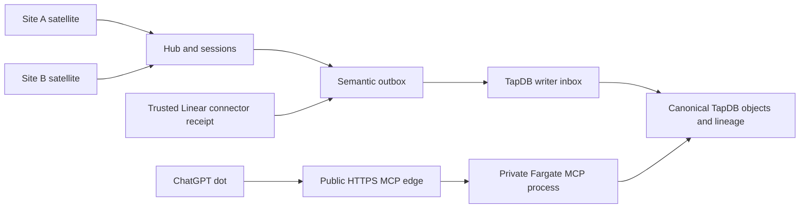

# Marvain 4.x source release and demonstration packet

**Status: scoped source integration prepared and untested; no release, build, deployment, live capture or acceptance.** This packet prepares decisions and is not authority to execute them. The owning execution plan is /Users/jmajor/projects/marvain/docs/plans/20261109_marvain_4x_multiagent_execution_plan.md.

## Intended service boundaries

The selected camera/microphone satellites connect to the Marvain hub and existing worker/recognition services. The TapDB writer and semantic outbox dispatcher persist canonical objects and lineage. Marvain operational rows hold transport and projection state. The dot MCP application uses a dedicated ASGI process with an explicitly configured OAuth resource and linked account binding. Daylily Linear owns the deliberately selected commitment. The provider owns native dot identity, subscriptions and tasks.



The diagram is the intended topology, not a deployment claim. Atomic graph queue/dispatch and selected scene evidence/memory producer source exist; the authenticated Linear receipt intake is mounted in source. Earlier record-only writes do not establish canonical scene memory. The writer's inbox owns graph retry idempotency; a queued operation is not a committed graph.

## Source preparation and release limits

1. Authenticated device, scene, session and principal associations and explicit raw-capture/audience/retention policy are wired in source. Source adds `/v1/scenes/provision`, `/v1/sessions/{session_id}/scene-provision`, explicit `MARVAIN_V4_BINDINGS_SECRET_ARN` route selection and policy-backed device token resolution. Missing or unwritten bindings fail closed. Policy-filtered scene recall uses `canonical_lexical_v1` over eligible content. The authenticated caretaker endpoint queues a lineage-backed association and requires actual configured human identity and caretaker authority.
2. The active evidence/episode/memory graph producers and authorized recall are wired in source: selected event evidence is queued once, and memory graphs link the written source evidence. Recall uses `canonical_lexical_v1` after policy filtering, ordered by term overlap, effective time and persisted identity; semantic/vector ranking remains future projection work. Human recognition review source links accepted decisions to the actual canonical person and source observation; existing persons without canonical source bindings require explicit provisioning. Source remains untested.
3. The selected satellite artifact intake is wired in source: source now adds hub-owned PUT using an upload intent and the S3 PUT result, and binds an available artifact to the authenticated event. The satellite client and platform support for versioned storage and request-size limits remain unverified; the hub PUT buffers the request body and the selected deployment transport limit has not been established. Existing `/v1/artifacts/presign` is absent; do not adopt the other completion route’s readback probes for this path.
4. Dot backend and dedicated-process CLI/configuration are integrated in source with canonical lifecycle, inbox idempotency, configured identity and policy. Writes resolve the current owning operational session status via the scene’s typed reference. The TapDB connection must also have access to the existing Marvain `sessions` table. MCP dependency is declared in source; no package installation occurred.
5. The authenticated Linear reporter intake and outbox are wired in source; provider delivery remains unselected. The configured reporter supplies its owning connector result; no provider signature or readback is implied. The pointer event can only be built after the writer returns the persisted handoff identity; provider delivery is unselected.
6. Session/device authorization and per-session routing are wired in source. Event query source supports session filtering and returns session identity; selected AV source carries occurrence and hub receipt separately. These changes are untested and do not prove two-scene isolation.

## Bootstrap order and source gaps

1. Select the actual service, TapDB connection and policy values. The existing `marvain init tapdb` command is the repository's template initialization entrypoint; select its real config and deployment scope before using it. It has not been run for this work.
2. The source routes `POST /v1/agents`, `POST /v1/spaces`, `POST /v1/devices/register`, and `POST /v1/agents/{agent_id}/people` persist operational rows and queue canonical records. The existing `marvain devices register` command invokes the device registration API. These routes return operational UUIDs. An authenticated admin uses `GET /v1/agents/{agent_id}/semantic-sources/{source_table}/{source_id}` for `agents`, `spaces`, `devices` or `people`; the response carries the persisted canonical identity only when the existing writer reports `written`. Administrative/bootstrap device paths do not yet create the same canonical record; use of those paths for a new 4.x route is an unresolved source gap.
3. An authenticated agent admin provisions the remaining canonical identities through the Hub. Each request uses an explicit new UUID `operation_id` and a real same-agent `space_id`; the response is queued, and `GET /v1/agents/{agent_id}/identity/operations/{operation_id}` returns the actual canonical identity only after the writer reports `written`:
   - `POST /v1/agents/{agent_id}/identity/animals`: `operation_id`, `space_id`, `display_name`, `species`.
   - `POST /v1/agents/{agent_id}/identity/principals`: `operation_id`, `space_id`, `actor_kind` (`human` or `software_agent`); human also supplies the same-agent `person_id`. The issuer and subject come from the authenticated user and configured Cognito issuer. A software binding represents this linked account; it does not attest native dot identity.
   - `POST /v1/agents/{agent_id}/identity/embodiments`: `operation_id`, `space_id`, `actor_kind` (`human`, `animal`, or `software_agent`), `actor_source_id`, `device_id`, and `display_name`. Actor source is the actual person UUID, animal operation UUID, or owning agent UUID respectively; device is the registered same-agent UUID.
   - `POST /v1/agents/{agent_id}/identity/caretakers`: `operation_id`, `space_id`, actual `person_id`, `animal_operation_id`, and `principal_operation_id`. The principal operation must be the authenticated user's own binding to that person. The resulting lineage records caretaker authority; observation association remains a separate explicit action.

   Source operations and graph writes use the existing transactional outbox/writer inbox. Use returned IDs and receipts; do not fabricate EUIDs or infer lineage from config. Existing records lacking canonical bindings require an explicitly selected owning procedure; no migration is implied.
4. After the owning identities, lineage and explicit policy exist, configure the route and call scene provision and status as described below. Supply the returned operational session UUID explicitly to each satellite. Only after separate capture authority and policy selection can the satellite be started. Configure and start dot only after its dedicated process and OAuth inputs are selected. No provisioning, capture or launch was performed here.

## Route provisioning source contract

Set the Hub SAM parameter `MarvainV4BindingsSecretArn` to the existing Secrets Manager ARN containing the operator-controlled bindings JSON. The Hub reads that selected secret on each binding request, so an authenticated operator can provision canonical identities before populating live route bindings. Its top-level `routes` array has one entry per exact authenticated `device_id`, `agent_id`, `space_id` tuple. Each entry requires actual `space_euid`, `device_euid`, `actor_euid`, `principal_euid`, and `policy`. The policy requires `owner_principal_euid`, `reader_principal_euids`, `allowed_purposes`, `raw_capture_allowed`, and a `retention` mapping with a decision for each of `raw_artifact`, `attributed_event`, `episode`, and `knowledge`. Each decision selects either `expires_at` or `retain_until_revoked`. Optional `revoked_at` is timezone-aware. A top-level `callers` array maps each authenticated `device_id` and `agent_id` to its actual `device_euid`, `actor_euid`, and `principal_euid`. The `daylily` object requires the configured `reporter_principal_euid`, `connection_id`, `account_id`, `workspace_id`, `team_id`, and `project_id` (explicitly null when none), and can specify `recipient_principal_euid`. A `humans` array maps authenticated `user_id` and Cognito `subject` to actual `issuer`, human `actor_euid` and `principal_euid` for recognition review. A `caretakers` array uses the same identity fields and requires actual `CARETAKER_OF` lineage for the animal. TapDB lineage owns the canonical identity and audience relationships.

An authenticated device with `events:write` can call `POST /v1/scenes/provision` with its actual `space_id` and a new operational UUID `session_id`. The response is `queued`, not a committed scene. The existing dispatcher/writer owns delivery. `GET /v1/sessions/{session_id}/scene-provision` returns the scene and session EUIDs only after the writer reports `written`, resolving the session through TapDB lineage. Then `POST /v1/livekit/device-token` requires that `session_id`; reconnect reuses the persisted room and returns the canonical IDs. This is source preparation only; no service was launched and no capture was authorized in this work. The source requires the listed real bootstrap inputs and live selections before a demonstration. The worker records memory submissions as pending; source-evidence ordering uses the existing writer retry controls.

## Sanitized binding shape

The following illustrates field names. Replace angle-bracket strings with actual owning-service values and choose each retention and purpose explicitly. Repeat array entries for each selected route, caller and human. Include `daylily` and `dot` when those integrations are selected.

```json
{
  "routes": [{
    "device_id": "<registered device UUID>", "agent_id": "<owning agent UUID>", "space_id": "<space UUID>",
    "space_euid": "<persisted space identity>", "device_euid": "<persisted device identity>",
    "actor_euid": "<persisted software actor identity>", "principal_euid": "<persisted software principal identity>",
    "policy": {
      "owner_principal_euid": "<persisted owner principal identity>",
      "reader_principal_euids": ["<persisted permitted reader principal identity>"],
      "allowed_purposes": ["recall", "detail"], "raw_capture_allowed": false,
      "retention": {
        "raw_artifact": {"retain_until_revoked": true},
        "attributed_event": {"retain_until_revoked": true},
        "episode": {"retain_until_revoked": true},
        "knowledge": {"retain_until_revoked": true}
      }
    }
  }],
  "callers": [{
    "device_id": "<authenticated caller device UUID>", "agent_id": "<owning agent UUID>",
    "device_euid": "<persisted caller device identity>", "actor_euid": "<persisted software actor identity>",
    "principal_euid": "<persisted software principal identity>"
  }],
  "humans": [{
    "user_id": "<authenticated user UUID>", "subject": "<Cognito subject>", "issuer": "<Cognito issuer>",
    "actor_euid": "<persisted human actor identity>", "principal_euid": "<persisted human principal identity>"
  }],
  "caretakers": [{
    "user_id": "<authenticated user UUID>", "subject": "<Cognito subject>", "issuer": "<Cognito issuer>",
    "actor_euid": "<persisted human actor identity>", "principal_euid": "<persisted human principal identity>"
  }],
  "daylily": {
    "reporter_principal_euid": "<persisted reporter principal identity>",
    "connection_id": "<owning connector identity>", "account_id": "<Linear account identity>",
    "workspace_id": "<Linear workspace identity>", "team_id": "<Linear team identity>",
    "project_id": null, "recipient_principal_euid": "<optional persisted recipient principal identity>"
  },
  "dot": {
    "events_mode": "disabled",
    "oauth": {"cognito_region": "<Cognito region>", "cognito_user_pool_id": "<user pool ID>",
      "client_id": "<OAuth client ID>", "resource_uri": "<absolute HTTPS MCP resource URI>",
      "run_scope": "<run scope>", "recall_scope": "<recall scope>", "update_scope": "<update scope>"},
    "binding": {"subject": "<Cognito subject>", "agent_id": "<owning agent UUID>",
      "actor_euid": "<persisted software actor identity>", "principal_euid": "<persisted software principal identity>",
      "scenes": [{"scene_euid": "<persisted scene identity>", "session_euid": "<persisted session identity>"}]}
  }
}
```

## Dedicated dot hosting

The deployment target selected for this source is AWS profile `lsmc`, account `108782052779`, in `us-east-2`. The dot stack exposes `/mcp` and its OAuth protected-resource metadata on the AWS-managed HTTPS API Gateway endpoint. A VPC link and Cloud Map SRV registration route requests to the dedicated private Fargate task in the Hub VPC. The task security group allows ingress from the VPC link and connects to Aurora and the Secrets Manager VPC endpoint. The task owns the MCP SDK lifespan and serves stateless JSON responses. The HTTP API integration has a 30-second maximum and uses buffered responses. Long-lived SSE falls outside this transport. [API Gateway private integrations](https://docs.aws.amazon.com/apigateway/latest/developerguide/http-api-develop-integrations-private.html) · [HTTP API limits](https://docs.aws.amazon.com/apigateway/latest/developerguide/http-api-quotas.html) · [Response streaming support](https://docs.aws.amazon.com/apigateway/latest/developerguide/http-api-vs-rest.html)

1. Build the final dot image on the designated EC2 builder from the exact annotated release tag. Use Linux x86-64, pass that numeric tag as `MARVAIN_RELEASE_VERSION`, and publish to `DotRepositoryUri` from the prerequisite stack with the same image tag. Keep the returned image digest for the dot service. [/Users/jmajor/projects/marvain/apps/dot_service/Dockerfile](/Users/jmajor/projects/marvain/apps/dot_service/Dockerfile) · [/Users/jmajor/projects/marvain/infrastructure/deployment_prerequisites.yaml](/Users/jmajor/projects/marvain/infrastructure/deployment_prerequisites.yaml)
2. Supply `DotImageRepositoryUri` from the prerequisite output and the VPC, two private subnets, ECS cluster, Aurora and Secrets Manager endpoint inputs from the Hub outputs. Select `DotRuntimeMode=disabled` for the initial HTTPS edge and record `DotMcpResourceUri` and `DotMcpResourceMetadataUri` from the stack. The disabled stage provisions the HTTPS edge and leaves the task pending its binding. [/Users/jmajor/projects/marvain/infrastructure/dot_service.yaml](/Users/jmajor/projects/marvain/infrastructure/dot_service.yaml)
3. Configure the selected Cognito managed-login client and the exact ChatGPT redirect URI and approved scopes. Use the returned `DotMcpResourceUri` as the OAuth resource and access-token audience. Add the actual linked subject, persisted actor/principal and allowed scene/session pairs to `dot` in the selected Secrets Manager binding. Scene update policy comes from the persisted scene. [Cognito resource binding](https://docs.aws.amazon.com/cognito/latest/developerguide/cognito-user-pools-define-resource-servers.html#cognito-user-pools-resource-binding)
4. After the linked binding is provisioned, select `DotRuntimeMode=enabled`, the final `DotImageDigest` and `DotBindingSecretArn`. The task runs `marvain dot serve --binding-secret-arn` with the selected ARN and `--resource-uri` with the stack's exact endpoint. Startup resolves the persisted bindings before serving. The CLI also accepts an absolute `--binding-file` for an explicitly selected standalone process.

The dot `recall(run_euid, source_scene_euid, query)` contract authorizes the current run separately and retrieves from the selected source scene and its persisted session. Retained closed scenes remain eligible when their current source policies allow recall. Results return through the authenticated MCP tool response.

## Dot event delivery source and live boundary

WP-10 source prepares the MCP Events list/subscribe/unsubscribe capability, durable subscription and delivery state, signed callbacks and the existing writer/SQS retry path. The event is a pointer to an actual persisted handoff; the writer commits canonical success before delivery, so an external callback failure does not downgrade that success. Existing queue redrive owns retries; the source does not claim a separate per-delivery exponential delay. A 410 or 413 is terminal for that delivery; 408, 425, 429 and 5xx responses use the existing retry path. A 410 does not itself stop the subscription. Fresh schema initialization includes the event transport tables.

This source remains untested and undeployed. A real connection, authorized subscription, OAuth event scope, callback endpoint and approved host, secret and reachable outbound network path must be selected before use. Nothing in this work created a subscription, delivered an event or activated a recurring process.

## Dot event configuration

Select `dot.events_mode` as `enabled` or `disabled` explicitly in the selected dot binding. Disabled mode omits `events_secret_arn`. Enabled mode uses the same selected ARN in `dot.events_secret_arn`, the dot stack's `DotEventsSecretArn`, and the Hub SAM writer's `DotEventsSecretArn` with `DotEventsMode=enabled`. The task and writer roles read the selected secret. Use separate live authority for a subscription.

The secret JSON has `encryption_key`, a Fernet-compatible 32-byte URL-safe base64 key, and `settings` containing explicit `event_scope`, `callback_hosts` (allowed exact lower-case DNS names), `subscription_ttl_ms`, `verification_cache_seconds`, `rotation_seconds`, and `callback_timeout_seconds`. Supply the approved values and secret through Secrets Manager. The Hub template supplies a NAT route for its private subnets so the writer and dot task have an outbound HTTPS path for delivery and callback verification.

## Inputs required for a future release

- Exact deployment configuration and runtime identities, the selected binding secret ARN for Hub SAM `MarvainV4BindingsSecretArn`, and the final annotated numeric 4.x tag and current-branch release commit.
- Designated EC2 builder for this service and image registry/repository; local container builds are prohibited. Only the final tagged revision/image may be built.
- Actual TapDB configuration, deployment of the added distinct scene template, explicitly persisted site/space, device, scene, session, actor and principal associations; actual two site endpoints and output routes.
- Actual participants, animal and explicit caretaker authority; raw-detail choice, retention decisions, audience/purpose grants, cross-site disclosure and capture permission.
- Dot OAuth issuer, resource audience, client/subject, actor/principal, allowed scene/session and update policy, dedicated service address and hosting identity.
- Exact Daylily Linear account, workspace, team, project, authenticated connector, intentional selected issue or create operation, original goals and substantive checkpoint. Event trigger, recipient and provider-supported subscription ownership remain separate selections. Durable event-delivery source is prepared; no provider subscription or event delivery has been activated.
- Separate authority for tag/build/deployment and separately authorized demonstration and user acceptance. Tests remain off absent the user's two explicit requests for the exact scope.

After those prerequisites are resolved, the release owner can prepare the precise existing Marvain CLI invocation against the selected configuration and the designated EC2 build workflow. Commit the in-scope source, create an immutable annotated numeric tag on that exact revision and deploy the final tagged image through the selected service's supported controls. Do not open a PR or merge without the separately required explicit requests. No command in this packet is a live-operation instruction.

## Future two-scene demonstration

With separately authorized participants, capture and policies, start the two explicitly bound sessions. At site A, retain the permitted details of a human and animal interaction, separating observation from the person's interpretation. At site B, hold an unrelated conversation and route its reply only to site B. In a later run, have the bound dot explicitly select the earlier site A source scene and request permitted episode detail while retaining its current output route; recall the site A sequence and its evidence, then correct a mistaken attribution and inspect the permitted current and historical views. Finally, deliberately hand off one commitment through the owning Linear connector and retain the real issue receipt, checkpoint and delivery/review state. Use normal owning-service results; no additional probes or test campaign are implied.

**Acceptance:** none. Scoped source is untested, unreleased and undeployed; no participant, device, subscription or cloud service has been activated by this packet.
