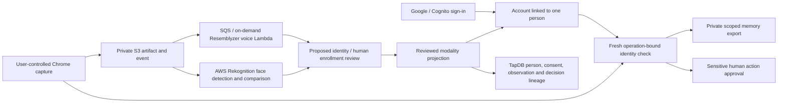

# Linked recognition and progressive acceptance

Source amendment for 4.0.9, with Hub corrections in 4.0.10 and deployment-command correction in 4.0.11. Hub 4.0.10 and voice image 4.0.9 are deployed. Deployment and user acceptance are recorded in the controlling 9 November ledger. Tests are written, unrun; live biometric acceptance remains pending.

Voice vectors remain operational projections in PostgreSQL. Face recognition uses reviewed private reference images and AWS CompareFaces; it does not fabricate embeddings or create an AWS face collection. `2016-06-27` is the AWS API contract version, not a claim about the undisclosed underlying model version. Canonical relationships and decision evidence use TapDB objects/lineage.

The check binds one Cognito subject, application user, signed browser session, linked person, purpose and target for five minutes. Either modality may be selected. When both are selected, both must identify the same expected person; missing, ambiguous or mismatching results do not authorize the operation. Consent and active enrollment are evaluated at use time. An enrollment candidate cannot be used as recognition evidence. Captures must be new events attached to that check. A consumed check cannot authorize another operation.

Recognition is a sanity check alongside account permissions. It is not proof of liveness, phishing-resistant MFA, or a guarantee against replayed images/voices. Sensitivity means manual approval of tools with mutation, communication or control scopes. Policy-driven automation keeps its existing approved controls; immediate manual approval cannot bypass the check. WebSocket approvals use the same central service and require the browser check for sensitive actions.

Private export selects canonical session memory through the existing memory policy evaluator and excludes unavailable records. It does not export raw media or claim to be a complete backup. Existing operational backup-manifest tooling is separate.

Removed obsolete paths: GUI direct embedding enrollment; GUI direct hypothesis accept/reject/no-match writes; browser artifact-key enrollment with inferred space; device direct voiceprint/faceprint creation/revocation that bypassed authenticated review. No compatibility alias is provided. Current endpoints are captured samples, reviewed hypotheses and projection revocation. Operational vector tables remain because they are the matching projections, not discarded historical junk.

The acceptance journey records the proven Google/Cognito → existing agent/space → canonical private browser binding → running responder → Chrome Join → microphone → Hello Marvain → audible reply → Leave sequence. New tests/features should move from pending to proven only with their actual acceptance receipt. Face, voice identity, dogs, recording persistence, recall and two locations remain pending.

AWS references: https://docs.aws.amazon.com/rekognition/latest/APIReference/API_CompareFaces.html and https://docs.aws.amazon.com/rekognition/latest/APIReference/API_DetectFaces.html . CompareFaces and DetectFaces are stateless; persistent reference artifacts stay in Marvain storage. Resemblyzer source/model package: https://github.com/resemble-ai/Resemblyzer .
